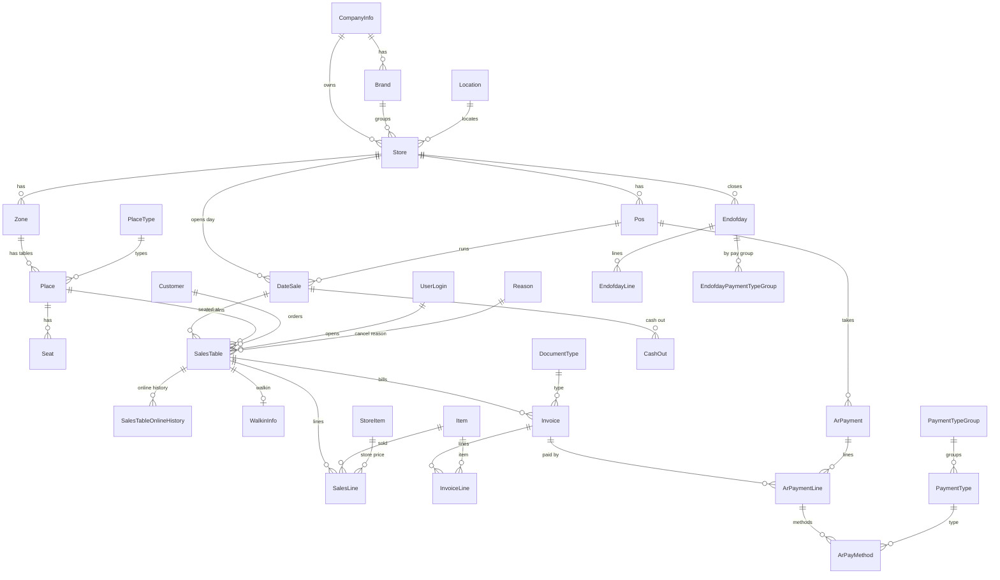

# 01 · POS Module (ระบบขายหน้าร้าน)

> สรุปจาก `01_FOC_POSModule V1.0.pdf` (176 หน้า, v1.0, 04/07/2023, บริษัท ฟู้ด ออเดอรี่ จำกัด)

## ภาพรวม

POS คือเว็บแอปที่แคชเชียร์และครัวของร้านค้าใช้ ทำหน้าที่ 2 อย่าง
1. ขายหน้าร้าน ได้แก่ เปิด/ปิดการขายรายวัน, เปิดบิลตามโต๊ะ, ส่งรายการเข้าครัว, เช็คบิล, พิมพ์ใบเสร็จ
2. รับ **ออเดอร์ออนไลน์** ที่เข้ามาจากแพลตฟอร์ม eatsHub (Web Ordering / Mobile App / Call Order / Chat Order) แล้วอัปเดตสถานะจนไรเดอร์ส่งถึงลูกค้า

- **Tech:** PHP 5.2.6 รันบน Windows Server 2019 ใช้ฐานข้อมูล MSSQL 2019 (`frsv345`) แยก 1 DB ต่อ 1 บริษัท
- **ภาษา:** สลับ TH/EN ได้

## สถาปัตยกรรมระบบรวม (Food Ordering Platform)

เอกสารทุกฉบับใช้แผนภาพเดียวกัน
- **ผู้ใช้:** ลูกค้า, ร้านค้า, คนขับ (Rider), เจ้าหน้าที่ Platform, Admin Platform
- **Application Layer**
  - `EATHUB-SERVICE-WEB-SERVER` (Ubuntu, CakePHP + Bootstrap, Flutter): Web Ordering, Management for Admin, Management for Store, Mobile App for Client / Store / Rider
  - `EATHUB-WEB-APP-SERVER` (Windows, PHP): **POS**
  - `EATHUB-API-GATEWAY-SERVER` (Windows, ASP.NET): JAPI Gateway + JAPI Backend Website
  - `EATHUB-LOG-API-SERVER`: Log API Gateway
- **API Layer:** Internal API, Rider API, POS API, Client API, Store API, JAPI Gateway Connector (Private/Public API)
- **Database:** Eatshub DB (MySQL 5.7), POS DB (MSSQL, 1 DB ต่อ 1 company), JAPI DB (MSSQL)
- **ระบบภายนอก:** Payment Gateway, Chat Order, Call Order, Google, SMS, Email, FOC
- **Production:** 7 servers (100 vCPU / 208 GB RAM) · **UAT:** 6 servers

## Workflow: รับออเดอร์ออนไลน์ของร้านค้า (POS)

Swimlane: **Customer → Cashier POS → Kitchen POS → Rider**

1. ลูกค้าสั่งออเดอร์ออนไลน์ → POS ได้รับแจ้ง สถานะ **รอรับออเดอร์**
2. ถ้ายังไม่เปิดการขาย ต้องเปิดการขายก่อน
3. ร้านเลือกได้ 2 ทาง
   - **ปฏิเสธ (Reject):** ยกเลิกพร้อมระบุเหตุผล → แจ้งลูกค้าและไรเดอร์
   - **รับออเดอร์:** สถานะ **รับออเดอร์** → แจ้งลูกค้าและไรเดอร์
4. เปิดบิลขาย → กรอกข้อมูล/เลือกเมนู → ส่งเข้าครัว → ครัวเตรียมอาหาร สถานะ **เตรียมอาหาร**
5. ครัวทำเสร็จ → เช็คบิล เลือกเครดิตออนไลน์ พิมพ์ใบเสร็จ
6. สถานะ **รอจัดส่ง** → ไรเดอร์ได้รับแจ้งและมารับอาหาร
7. ไรเดอร์รับอาหาร → สถานะ **กำลังจัดส่ง** → ลูกค้าได้รับแจ้ง "กำลังจัดส่ง" และ "ใกล้ถึง"
8. ลูกค้าได้รับอาหาร → ไรเดอร์กดจัดส่งแล้ว → สถานะ **จัดส่งเรียบร้อย (Delivered)**
9. ลูกค้ารีวิวร้านและคนขับ

### ลำดับสถานะออเดอร์ออนไลน์

```
รอรับออเดอร์ → รับออเดอร์ → เตรียมอาหาร → รอจัดส่ง → กำลังจัดส่ง → จัดส่งเรียบร้อย
       └──────────── ยกเลิกได้ (ต้องระบุเหตุผล) ────────────┘
```
ยกเลิกได้เฉพาะ 4 สถานะแรก (รอรับออเดอร์, รับออเดอร์, เตรียมอาหาร, รอจัดส่ง) และในตารางแต่ละสถานะจะแสดงเป็น badge สีต่างกัน

## Sitemap

- **เข้าสู่ระบบ:** Username, Password, เลือกร้าน
- **Header:** ข้อมูลผู้ใช้งาน · รายการแจ้งเตือน (รายการคำสั่งซื้อ, ข่าวสาร/โปรโมชั่น) · โหลดใหม่ · Chat (คนขับ, ลูกค้า) · เปลี่ยนภาษา (TH/EN)
- **เมนูหลัก**
  - **Home**
  - **การขาย:** เปิดบิลขาย, โปรโมชั่น, บิลขายล่าสุด, ออกใบกำกับภาษี, เปิดการขาย, เงินออก, ปิดการขาย, การจัดการพื้นที่ร้าน, ชนิดพรีเพด, พรีเพด
  - **ออนไลน์:** รายการออนไลน์
  - **สมาชิก:** การจัดการลูกค้า, กำหนดกลุ่มของช่องข้อมูล, สร้างช่องข้อมูลเอง, บัตรสะสมคะแนน, โปรโมชั่นสะสมคะแนน, ชั้นบัตรสมาชิก
  - **คลังสินค้า:** รายการสินค้า, กลุ่มสินค้า, ชนิดของสินค้า, ข้อความเพิ่มเติม (Add-on text), ตั้งต้นสินค้า, รับสินค้าเข้าแบบพิเศษ
  - **ผู้ดูแลระบบ:** แผนก, ข้อมูลพนักงาน, กลุ่มผู้ใช้, ผู้ใช้งานระบบ, สิทธิ์ผู้ใช้งาน, ข้อมูลบริษัท, ร้านค้า, กลุ่มรูปแบบการชำระเงิน, วิธีการชำระเงิน, เหตุผล, ปริ้นเตอร์ส่งอาหาร, จัดการใบเสร็จ
  - **รายงาน**
    - การขาย: ยอดขายแยกประเภท, ขายสินค้า, ยอดขายประจำสัปดาห์, ขายแบบกลุ่ม, ขายตามประเภทการจ่ายเงิน, สินค้ายอดนิยม 10 อันดับ, ยกเลิกใบเสร็จ, คูปอง, ส่วนลด, สรุปยอดขาย, ใบเสร็จย่อทั้งหมด, ยอดขายพนักงาน, สรุปยอดขายรายวัน, ยอดขายกลุ่มสร้างเอง, สินค้าขายตามเมนู, ค่าคอมมิชชั่น, Entertain, ภาษี, รายได้, กราฟยอดขายสินค้า, ขายที่ยกเลิก, ยอดรวมใบเสร็จและเซอร์วิสชาร์จ
    - สินค้า: สินค้าต่ำกว่าสต็อก, การเคลื่อนไหวสต็อก
    - ผู้บริหาร: ต้นทุนสินค้าและกำไร, ยอดขายพนักงาน, สรุปยอดขายรายวัน
  - **ออกจากระบบ**
- **Link Monitor (Kitchen):** จอครัวพื้นดำ แสดงออเดอร์เข้า (แถบแดง "1 Order / 1 Dish")

## ลำดับหน้าจอสำคัญ

| Flow | หน้าจอ |
|---|---|
| เข้าสู่ระบบ | Sign In (Username/Password/เลือกร้าน) → Home แสดงกริดรูปเมนูอาหาร |
| เมนูการขายหน้าร้าน | หน้าแรกเป็น tile สี: เปิดบิลขาย, โปรโมชั่น, บิลขายล่าสุด, ออกใบกำกับภาษี, เปิด/ปิดการขาย, เงินออก, จัดการพื้นที่ร้าน, ชนิดพรีเพด, พรีเพด |
| เปิดการขายรายวัน | กรอก Username/Password ของผู้เปิด, เงินเปิดลิ้นชัก, วันที่ขาย → พิมพ์บิลเปิดการขาย |
| ปิดการขายรายวัน | แท็บ: แจ้งเตือน (บิลที่ยังไม่ชำระ), ยอดตามประเภทการชำระเงิน, สรุปยอดขาย, ยอดตามประเภทสินค้า, สรุปส่วนลด → ปิดการขาย → พิมพ์บิลปิด → ระบบ Sign out อัตโนมัติ |
| เปิดบิลขาย | ผังโต๊ะแยก Zone A–E/Take Away (โต๊ะว่างสีเขียว, มีลูกค้าสีแดง) → ระบุจำนวนลูกค้า → เลือกสมาชิก/พนักงานขาย → เลือกหมวด (Sushi, Sashimi, Maki, …) → เลือกเมนูแบบรูปภาพ → Add-on (เพิ่มเติม) → เครื่องมือ (ย้าย/รวมโต๊ะ, ส่วนลด, ยกเลิก) → ส่งอาหารเข้าครัว → จอ Monitor ครัว |
| ปิดบิลขาย | บิลขายล่าสุด → เช็คบิล (สรุป + เลือกโปรโมชั่น) → ชำระเงิน (เงินสดตามธนบัตร, VISA, Master, AMEX, Entertain, บัตรกำนัล, เครดิตออนไลน์, คูปอง) → สรุปบิล/เงินทอน → พิมพ์ใบเสร็จ |
| รับออเดอร์ออนไลน์ | รายการออนไลน์ (ค้นหาตามวันที่/สถานะ) → คลิกเลขออเดอร์ดูรายละเอียด/รับออเดอร์ หรือคลิก badge สถานะ → เปิดบิลขาย → ส่งเข้าครัว → ปรับสถานะทีละขั้น |

## ข้อมูลที่ใช้ทำ Mockup ได้

- **ข้อมูลในบิล:** รวมเงิน, ส่วนลด, Service charge 10%, VAT 7%, ยอดสุทธิ
- **ข้อมูลออเดอร์ออนไลน์:** เลขที่ (เช่น `EH-BKK-210224-00166`), วันที่สั่ง, ชื่อลูกค้า, สถานะ, วันที่อัปเดต, พนักงาน
- **ตัวอย่างเมนูในเอกสาร:** ร้านซูชิ (Otoro, Engawa, Salmon, Foie Gras Sushi ฯลฯ ราคา 85–390 บาท)

## การตั้งค่าระบบ (Parameters)

- `/frs/include/config.php`: ค่า SMTP, charset, `$dbPlatform`
- `/frs/include/globalVar.php`: `Email_Allow_Send`, `Platform_UserLogin_Max`, `Other_Company_UserLogin_Max`
- `/frs/company/[Domain].ini`: config DB แยกตามโดเมนร้าน, `iscloud`

## ฐานข้อมูล (Database)

- **DBMS:** MSSQL 2019 · ชื่อฐานข้อมูล `frsv345` · **1 DB ต่อ 1 บริษัท** (config แยกตามโดเมนที่ `/frs/company/[Domain].ini`)
- **ขนาด:** 136 ตาราง แยกจาก eatsHub platform DB (MySQL `eatshub`) โดยเชื่อมกันผ่าน POS API / JAPI
- **รูปแบบ:** ชื่อตารางและคอลัมน์เป็น PascalCase, ใช้ `int(auto)` เป็น PK, สถานะส่วนใหญ่เป็น `nvarchar(1)` (`1` = ใช้งาน, `0` = ไม่ใช้งาน), เก็บชื่อ 2 ภาษา (`NameLocal` / `NameEng`) และมีคอลัมน์ audit (`CreatedDate`, `CreatedBy`, `ModifiedDate`, `ModifiedBy`) เกือบทุกตาราง

### จุดเชื่อมกับ eatsHub Platform (ออเดอร์ออนไลน์)

เมื่อออเดอร์ออนไลน์เข้ามาที่ร้าน POS จะสร้างบิลใน `SalesTable` แล้วผูกกับออเดอร์ของแพลตฟอร์ม

| คอลัมน์ใน `SalesTable` | ความหมาย |
|---|---|
| `EatshubOrderId` (int) | ID ออเดอร์ของ eatsHub (อ้างอิง `orders.id` ใน MySQL `eatshub`) |
| `OnlineStatus` (nvarchar 25) | `wait` = สร้างออเดอร์ → `inprocess` = กดรับแล้วกำลังเตรียมอาหาร → `delivery` = กดจัดส่ง รอไรเดอร์ → `complete` = เสร็จสิ้น · `cancel` = ยกเลิก |
| `CancelRemark` | หมายเหตุกรณียกเลิก |
| `FlagTime` | 0 = ค่าเริ่มต้น/มีการอัปเดต, 1 = interface เสร็จแล้ว |

ประวัติการเปลี่ยนสถานะเก็บใน `SalesTableOnlineHistory` (`SaleId` → `SalesTable.SalesId`) · สถานะรายการอาหารเก็บใน `SalesLine.Status` / `CookStatus` (0 = Order, 1 = Send Order เข้าครัว, 2 = Cancel)

### ER Diagram (หัวข้อ 6, หน้า 56–76)

ER Diagram ในเอกสารมี 21 หน้า แต่ละหน้าแสดงตารางกลุ่มหนึ่งกับตารางหลักที่ใช้ร่วม (`Store`, `Item`, `UserLogin`, `Customer`, `Pos` ปรากฏซ้ำหลายหน้า) สรุปความสัมพันธ์ได้ดังนี้

#### แกนหลักของการขาย



#### ความสัมพันธ์แยกตามหน้า

| หน้า | กลุ่ม | ความสัมพันธ์หลัก |
|---|---|---|
| 56 | ร้านค้า ผู้ใช้ การชำระเงิน | `ClarifyText` → `AddRequestItem` ← `Item` (Add-on ของเมนู) · `UserLogin` ↔ `ActiveStore` ↔ `Store` (ผู้ใช้เข้าได้หลายร้าน) · `ArPayment` → `ArPaymentLine` → `ArPayMethod` → `PaymentType` → `PaymentTypeGroup` · `ArPayment` → `Pos` → `Store` · `Store` → `Brand` → `CompanyInfo` · `ApiSetting` (เดี่ยว) |
| 57 | สมาชิกและแคมเปญ | `Customer` → `CustomerDefine1` → `Define1` (ฟิลด์กำหนดเอง) · `Customer` → `LoyaltyCardCustomer` → `LoyaltyCard` · `LoyaltyCardCustomer` → `CardHistory` · `Campaign` → `CampaignPeriod` / `CampaignStore` / `CampaignMember` (→ `LoyaltyCard`) / `CampaignPromotion` → `Promotion` · `Period` |
| 58 | ผู้ใช้ เปิดการขาย ฟิลด์กำหนดเอง | `DateSale` → `Pos`, `Store` · `CashOut` → `DateSale`, `UserLogin` · `Custom_Notification` → `Custom_Notifications_Group`, `UserLogin` · `ClockInOut` → `UserLogin` · `UserLogin` → `Store`, `Department` · `Define1` → `DefineGroup`, `FieldType` · `DefineItem` → `FieldType`, `DefineGroupItem` · `CustTaxInv`, `Currency` (เดี่ยว) |
| 59 | ปิดการขายและสิทธิ์ | `Endofday` → `EndofdayLine`, `EndofdayPaymentTypeGroup` (→ `PaymentTypeGroup`) · `Endofday` → `Pos`, `Store`, `UserLogin` · `UserLogin` → `UserGroup` → `GroupRole` → `Role` · `Employee` → `Department`, `UserLogin` · `FormReceipt` → `CompanyInfo` · `EmenuMemory`, `EmenuPicture`, `EmenuPicCat`, `EmenuKnowledge`, `DocumentType`, `FieldType` |
| 60 | มัดจำ กลุ่มค้นหา มิติสินค้า | `Deposit` → `Customer`, `Item` · `GroupItemFilter` → `GroupItemFilterLine` → `Item` · `Dimension` → `DimDetail` → `DimLine` · `DimGrid` · `Customer` → `Store` |
| 61 | ความเคลื่อนไหวสต็อก | `InventTrans` → `Item`, `StoreItem`, `Customer`, `Pos` · `StoreItem` → `Item` |
| 62 | ใบเสร็จ | `Invoice` → `SalesTable`, `Customer`, `UserLogin`, `Pos`, `Place`, `DateSale`, `Store`, `DocumentType` |
| 63 | รายการในใบเสร็จ | `Invoice` → `InvoiceLine` → `Item`, `StoreItem`, `UserLogin` |
| 64 | สินค้า | `Item` → `ItemMultiGroup` → `ItemGroup` · `Item` → `Kitchen` (ครัวที่ทำ) · `Item` → `ItemTax` → `Tax` · `Item` → `ItemDeduct` (ตัดสต็อก) · `Promotion` → `ItemPromotion` → `GroupItemFilter` · `ItemDimension` → `DimGrid` · `ItemType`, `ItemGroupDefine` |
| 65 | พื้นที่ร้านและบัตรสมาชิก | `Store` → `Zone` → `Place` → `PlaceType` · `Store` → `Location` · `Customer` / `Store` → `LoyaltyCardCustomer` → `LoyaltyCard` · `PaymentType` → `PaymentTypeGroup` · `Lot`, `Persons`, `Line`, `Period`, `OptionApp` |
| 66 | ใบสั่งจองสินค้า | `Supplier` → `PreOrder` → `PreOrderLine` → `Item` · `PreOrder` → `Store` (สร้าง/รับ) · `Pos` → `PosCheckSum` |
| 67 | พรีเพด | `PrepaidType` → `PrepaidCard` → `Store`, `UserLogin` · `PrepaidHistory` → `DocumentType`, `DateSale`, `Pos` · `PrepaidCustomer` |
| 68 | โปรโมชั่นร้านและปริ้นเตอร์ | `Promotion` → `SalePromotion` → `PromotionStoreItem` → `Store`, `Item` · `Printer` → `Store`, `Zone` (ปริ้นเตอร์ส่งอาหารตามโซน/ครัว) · `PromotionType` |
| 69 | จัดซื้อ | `Supplier` → `PurchaseOrder` → `PurchaseLine` → `Item` · `Supplier` → `PurReceive` → `PurReceiveLine` · `Supplier` → `PurInvoice` → `PurInvoiceLine` · `PreOrder` → `PurchaseOrder` · ทุกเอกสาร → `Store` (`CreatedStoreId`, `ReceiveStoreId`) |
| 70 | จองโต๊ะและรายงาน | `Reserve` → `ReserveLine` → `Item` · `Reserve` → `Place` · `ReportMain` → `ReportCriteria`, `ReportSchema` · `Role`, `RoleCategory`, `Reason`, `SalePageGui`, `SalePageOption` |
| 71 | รายการขาย | `SalesTable` → `SalesLine` → `Item`, `StoreItem`, `UserLogin`, `Reason` · `SalePromotion` → `GroupItemFilter`, `Promotion` · `UserLogin` → `SaleTarget` |
| 72 | บิลขาย | `SalesTable` → `Place`, `Reason`, `DateSale`, `Pos`, `Store`, `Customer`, `UserLogin` · `SalesTable` → `SalesTableOnlineHistory` |
| 73 | สต็อกและครัว | `Lot` → `Serial` → `Item` · `StockTake` → `StockTakeLine` → `Item` · `ItemGroup` → `StockRawMaterial` → `Kitchen` · `Item` → `ItemGroup`, `Kitchen` · `Place` → `Seat` · `StockSend`, `StockBalance`, `StockHoliday`, `StockPar` |
| 74 | ตั้งค่าร้าน | `Store` → `StoreOption` → `OptionApp` · `StoreGroup` → `StoreGroupMem` → `StoreLinkGroupMem` → `Store` · `Store` → `StoreTarget`, `StoreItem`, `StoreItemGroup`, `Location`, `Brand`, `CompanyInfo` |
| 75 | โอนย้ายสินค้า | `Transfer` → `TransferLine` → `StoreItem`, `Item` · `Transfer` → `DocumentType`, `UserLogin`, `Store` (ผู้ส่ง/ผู้รับ) · `Supplier` → `SuppItemGroup` → `Item` · `Tax` |
| 76 | ผู้ใช้ออนไลน์ | `UserLogin` → `UserGroup`, `Employee`, `Store` · `UserOnline` → `UserLogin`, `Pos`, `Store` · `SalesTable` → `WalkinInfo`, `UserLogin`, `Pos`, `Store` · `Store` → `Zone` · `UserHistory`, `Unit` |

### Data Dictionary (ทุกตาราง)

ทั้งหมด **136 ตาราง / 1591 คอลัมน์** จัดกลุ่มตามหน้าที่ และดึงมาจากหัวข้อ 7 ของเอกสาร
- 🔑 = Primary key ตามที่เอกสารระบุ (บางตารางเอกสารไม่ได้ระบุ PK)
- คอลัมน์ audit `CreatedDate` / `CreatedBy` / `ModifiedDate` / `ModifiedBy` มีเกือบทุกตาราง จึงไม่แสดงซ้ำในตาราง แต่ระบุไว้ท้ายชื่อตารางเป็น *(+audit)*

#### บริษัท ร้านค้า และเครื่อง POS (24 ตาราง)

<details><summary><b>CompanyInfo</b>: ตารางข้อมูลบริษัท</summary>

| คอลัมน์ | ชนิด | Null | คำอธิบาย |
|---|---|---|---|
| 🔑 `CpId` | int(auto) | No | Auto ID บริษัท |
| `CpName` | nvarchar(150) | Yes | ชื่อบริษัท |
| `CpNameInter` | nvarchar(150) | Yes | ชื่อบริษัท (ภาษาอังกฤษ) |
| `DomainName` | nvarchar(150) | Yes | Domain Name POS |
| `Address` | nvarchar(250) | Yes | ที่อยู่บริษัท |
| `AddressInter` | nvarchar(250) | Yes | ที่อยู่บริษัท (ภาษาอังกฤษ) |
| `Tel` | nvarchar(50) | Yes | หมายเลขโทรศัพท์ |
| `Fax` | nvarchar(50) | Yes | หมายเลขโทรสาร |
| `Zipcode` | nvarchar(50) | Yes | รหัสไปรษณีย์ |
| `Email` | nvarchar(50) | Yes | ที่อยู่ Email |
| `TaxId` | nvarchar(50) | Yes | รหัสประจำตัวผู้เสียภาษี |
| `Logo` | nvarchar(50) | Yes | รูปภาพสัญลักษณ์บริษัท |
| `CpCode` | nvarchar(20) | Yes | รหัสบริษัท |

</details>

<details><summary><b>Brand</b>: ตารางข้อมูลแบรนด์ <i>(+audit)</i></summary>

| คอลัมน์ | ชนิด | Null | คำอธิบาย |
|---|---|---|---|
| 🔑 `BrandId` | int(auto) | No | Auto ID รหัสแบรนด์ |
| `BrandName` | nvarchar(50) | Yes | ชื่อแบรนด์ |
| `CpId` | int | Yes | รหัสบริษัท  Ref. CompanyInfo.CpId |

</details>

<details><summary><b>Store</b>: ตารางข้อมูลร้านค้า <i>(+audit)</i></summary>

| คอลัมน์ | ชนิด | Null | คำอธิบาย |
|---|---|---|---|
| 🔑 `StoreId` | int(auto) | No | Auto ID รหัสร้านค้า |
| `StoreName` | nvarchar(50) | Yes | ชื่อร้านค้า |
| `Address1` | nvarchar(150) | Yes | ที่อยู่ 1 |
| `Address2` | nvarchar(150) | Yes | ที่อยู่ 2 |
| `City` | nvarchar(40) | Yes | ชื่อจังหวัด |
| `Country` | nvarchar(40) | Yes | ประเทศที่ตั้งร้านค้า |
| `PostCode` | nvarchar(10) | Yes | รหัสไปรษณีย์ |
| `Tel` | nvarchar(15) | Yes | หมายเลขโทรศัพท์ |
| `Fax` | nvarchar(15) | Yes | หมายเลขโทรสาร |
| `Email` | nvarchar(45) | Yes | ที่อยู่ email |
| `BrandId` | int | Yes | Tbl Brand.BrandId |
| `LocId` | int | Yes | ที่ตั้งร้านค้า Ref. Location.LocId |
| `Status` | nchar(1) | Yes | สถานะ (0 = ไม่ใช้งาน, 1 = ใช้งาน) |
| `WareHouse` | nchar(1) | Yes | เป็นคลังสินค้า? |
| `StrGroupMemId` | int | Yes | รหัสสมาชิกกลุ่มร้านค้า Ref. StoreGroupMem.StrGroup MemId |
| `SaleTarget` | real | Yes | เป้าขาย |
| `Sat` | varchar(1) | Yes | วันเปิดทำการ ส. (0 = ไม่เปิด, 1 = เปิด) |
| `Mon` | varchar(1) | Yes | วันเปิดทำการ จ. (0 = ไม่เปิด, 1 = เปิด) |
| `Tue` | varchar(1) | Yes | วันเปิดทำการ อ. (0 = ไม่เปิด, 1 = เปิด) |
| `Wed` | varchar(1) | Yes | วันเปิดทำการ พ. (0 = ไม่เปิด, 1 = เปิด) |
| `Thu` | varchar(1) | Yes | วันเปิดทำการ พฤ. (0 = ไม่เปิด , 1 = เปิด) |
| `Fri` | varchar(1) | Yes | วันเปิดทำการ ศ. (0 = ไม่เปิด, 1 = เปิด) |
| `Sun` | varchar(1) | Yes | วันเปิดทำการ อา. (0 = ไม่เปิด, 1 = เปิด) |
| `DeliveryFeq` | int | Yes | จำนวนจัดส่ง |
| `DeliveryDay` | int | Yes | จำนวนวันจัดส่ง |
| `DayOfStock` | int | Yes | วันที่สต๊อก |
| `StoreNum` | nvarchar(50) | Yes | โค๊ดร้านค้า |
| `GroupNum` | nvarchar(50) | Yes | โค๊ดกลุ่ม |
| `BusinessType` | nvarchar(30) | Yes | ประเภทร้านค้า |
| `IncVat` | nvarchar(1) | Yes | ราคารวมภาษี (0 = ไม่รวมภาษี, 1 = รวมภาษี) |
| `Vat` | float | Yes | อัตราภาษี % |
| `IncSerCharge` | nvarchar(1) | Yes | ราคารวมค่าบริการ (0 = ไม่รวมค่าบริการ, 1 = รวมค่าบริการ) |
| `SerCharge` | float | Yes | อัตราค่าบริการ % |
| `CpId` | int | Yes | รหัสบริษัท Ref. CompanyInfo.CpId |
| `StoreCode` | nvarchar(25) | Yes | รหัสร้านค้า |

</details>

<details><summary><b>StoreOption</b>: ตารางข้อมูล Option ของร้านค้า <i>(+audit)</i></summary>

| คอลัมน์ | ชนิด | Null | คำอธิบาย |
|---|---|---|---|
| 🔑 `StoreOpId` | int(auto) | No | Auto ID รหัส StoreOption |
| `StoreId` | int | Yes | รหัสร้านค้า Ref. Store.StoreId |
| `OpId` | int | Yes | รหัส option Ref. OptionApp.OpId |
| `Value` | nvarchar(50) | Yes | ค่าสำหรับ option |

</details>

<details><summary><b>OptionApp</b>: ตารางข้อมูล Option</summary>

| คอลัมน์ | ชนิด | Null | คำอธิบาย |
|---|---|---|---|
| 🔑 `OpId` | int | No | ID Option |
| `OpType` | nvarchar(10) | Yes | ประเภท Option |
| `OpName` | nvarchar(20) | Yes | ชื่อ Option |
| `NameLocal` | nvarchar(60) | Yes | รายละเอียด Option |
| `NameEng` | nvarchar(60) | Yes | รายละเอียด Optionภาษาอังกฤษ |
| `InputType` | nvarchar(10) | Yes | ประเภท Option |
| `OpGroup` | nvarchar(10) | Yes | ID กลุ่ม Option |
| `OpGName` | nvarchar(30) | Yes | ชื่อกลุ่ม Option |
| `Value` | nvarchar(10) | Yes | ค่า |
| `Status` | nchar(1) | Yes | สถานะ (0 = ไม่ใช้งาน, 1 = ใช้งาน) |
| `LastUpdate` | smalldatetime | Yes | วันที่แก้ไข |
| `UpdateBy` | smallint | Yes | ผู้แก้ไข |

</details>

<details><summary><b>StoreGroup</b>: ตารางข้อมูลกลุ่มร้านค้า <i>(+audit)</i></summary>

| คอลัมน์ | ชนิด | Null | คำอธิบาย |
|---|---|---|---|
| 🔑 `StrGroupID` | int(auto) | No | Auto ID รหัสกลุ่มร้านค้า |
| `NameLocal` | nvarchar(150) | Yes | ชื่อ |
| `NameEng` | nvarchar(150) | Yes | ชื่อ ภาษาอังกฤษ |
| `Status` | nvarchar(1) | Yes | สถานะ (0 = ไม่ใช้งาน, 1 = ใช้งาน) |
| `Sequence` | int | Yes | ลำดับที่แสดง |

</details>

<details><summary><b>StoreGroupMem</b>: ตารางข้อมูลสมาชิกกลุ่มร้านค้า <i>(+audit)</i></summary>

| คอลัมน์ | ชนิด | Null | คำอธิบาย |
|---|---|---|---|
| 🔑 `StrGroupMemId` | int(auto) | No | Auto ID รหัสสมาชิกกลุ่ม ร้านค้า |
| `StrGroupID` | int | Yes | รหัสกลุ่มร้านค้า Ref. StoreGroup.StrGroupID |
| `DataMember` | nvarchar(150) | Yes | ข้อมูลสมาชิก |

</details>

<details><summary><b>StoreLinkGroupMem</b>: ตารางข้อมูลสมาชิกกลุ่มของร้านค้า <i>(+audit)</i></summary>

| คอลัมน์ | ชนิด | Null | คำอธิบาย |
|---|---|---|---|
| 🔑 `StoreLinkGpMemId` | int(auto) | No | Auto ID |
| `StrGroupMemId` | int | Yes | รหัสสมาชิกกลุ่มร้านค้า Ref. StoreItemGroup.StrGroup MemId |
| `StoreId` | int | Yes | รหัสร้านค้า Ref. Store.StoreId |

</details>

<details><summary><b>StoreTarget</b>: ตารางข้อมูลเป้าขายของร้านค้า</summary>

| คอลัมน์ | ชนิด | Null | คำอธิบาย |
|---|---|---|---|
| 🔑 `StoreTargetId` | int(auto) | No | Auto ID รหัสเป้ายอดขาย |
| `StoreId` | int | No | รหัสร้านค้า Ref. Store.StoreId |
| `MonthId` | int | No | รหัสเดือน |
| `Year` | int | No | ปี |
| `Target` | real | No | เป้ายอดขาย |
| `TotalSale` | real | No | ยอดขายรวม |
| `TotalService` | real | No | ยอดบริการ |
| `NumOfItem` | int | No | จำนวนสินค้าที่ขาย |
| `NumOfCustomer` | int | No | จำนวนลูกค้า |
| `NumOfLoyalCust` | int | No | จำนวนสมาชิก |
| `AvgUnitSale` | float | No | จำนวนเฉลี่ยที่ขายได้ |
| `ItemPerBill` | float | No | จำนวนสินค้าต่อใบเสร็จ |

</details>

<details><summary><b>Location</b>: ตารางข้อมูลที่ตั้งสถานที่ <i>(+audit)</i></summary>

| คอลัมน์ | ชนิด | Null | คำอธิบาย |
|---|---|---|---|
| 🔑 `LocId` | int(auto) | No | Auto ID รหัสสถานที่ |
| `LocName` | nvarchar(50) | Yes | ชื่อสถานที่ |
| `Status` | int | Yes | สถานะ (0 = ไม่ใช้งาน, 1 = ใช้งาน) |

</details>

<details><summary><b>Pos</b>: ตารางข้อมูล Pos <i>(+audit)</i></summary>

| คอลัมน์ | ชนิด | Null | คำอธิบาย |
|---|---|---|---|
| 🔑 `PosId` | int(auto) | No | Auto ID รหัส Pos |
| `PosName` | nvarchar(20) | Yes | ชื่อ Pos |
| `Status` | nchar(1) | Yes | สถานะ (0 = ไม่ใช้งาน, 1 = ใช้งาน) |
| `StoreId` | int | Yes | รหัสร้านค้า Ref. Store.StoreId |
| `MacAddress` | nvarchar(20) | Yes | รหัสเครื่องที่ใช้สมัคร |
| `LicenseCode` | nvarchar(40) | Yes | รหัส License |
| `PosRdCode` | nvarchar(50) | Yes | รหัสเสียภาษี |

</details>

<details><summary><b>PosCheckSum</b>: ตารางข้อมูลตรวจสอบ Pos</summary>

| คอลัมน์ | ชนิด | Null | คำอธิบาย |
|---|---|---|---|
| 🔑 `PosId` | int | No | รหัส Pos Ref. Pos.PosId |
| `CheckSum` | int | No | Check Sum ตรวจสอบรวม |
| `DupCount` | smallint | Yes | Dup Count นับซ้ำ |
| `DupDate` | smalldatetime | Yes | Dup Date วันซ้ำ |

</details>

<details><summary><b>Zone</b>: ตารางข้อมูลโซน <i>(+audit)</i></summary>

| คอลัมน์ | ชนิด | Null | คำอธิบาย |
|---|---|---|---|
| 🔑 `ZoneId` | int(auto) | No | Auto ID รหัสรายการ |
| `ZoneName` | nvarchar(30) | Yes | ชื่อ Zone |
| `Description` | nvarchar(50) | Yes | รายละเอียด |
| `ZoneImage` | nvarchar(30) | Yes | รูปภาพ |
| `BgColor` | nvarchar(10) | Yes | สีพื้นหลัง |
| `Status` | char(1) | Yes | สถานะ (0 = ไม่ใช้งาน, 1 = ใช้งาน) |
| `StoreId` | int | Yes | รหัสร้านค้า Ref. Store.StoreId |
| `TakeAway` | nvarchar(2) | Yes | รับสินค้ากลับบ้าน (0 = ใช้บริการในร้าน, 1 = รับสินค้ากลับบ้าน) |

</details>

<details><summary><b>Place</b>: ตารางข้อมูลสถานที่ <i>(+audit)</i></summary>

| คอลัมน์ | ชนิด | Null | คำอธิบาย |
|---|---|---|---|
| 🔑 `PlaceId` | int(auto) | No | Auto ID รหัสสถานที่ Place.PlaceId |
| `PlaceName` | nvarchar(20) | Yes | ชื่อสถานที่ |
| `Description` | nvarchar(50) | Yes | คำอธิบาย |
| `PlaceTypeId` | int | Yes | รหัสประเภทสถานที่ Ref. PlaceType.PlaceTypeId |
| `ZoneId` | int | Yes | รหัสโซน Ref. Zone.ZoneId |
| `Reserve` | nchar(1) | Yes | สถานะ (0 = ใช้งานได้, 1 =จอง) |
| `LeftPx` | float | Yes | ตำแหน่งจากทางซ้าย |
| `TopPx` | float | Yes | ตำแหน่งจากด้านบน |
| `Status` | nchar(1) | Yes | สถานะ (0 = ไม่ใช้งาน, 1 = ใช้งาน) |
| `ParentPlaceId` | int | Yes | รหัสสถานที่หลัก Ref. |

</details>

<details><summary><b>PlaceType</b>: ตารางข้อมูลประเภทสถานที่ <i>(+audit)</i></summary>

| คอลัมน์ | ชนิด | Null | คำอธิบาย |
|---|---|---|---|
| 🔑 `PlaceTypeId` | int(auto) | No | Auto ID รหัสประเภทสถานที่ |
| `PTypeName` | nvarchar(20) | Yes | ชื่อประเภทสถานที่ |
| `PTypeImage` | nvarchar(50) | Yes | รูปประเภทสถานที่ 1 |
| `PTypeImage2` | nvarchar(50) | Yes | รูปประเภทสถานที่ 2 |
| `Status` | char(1) | Yes | สถานะ (0 = ไม่ใช้งาน, 1 = ใช้งาน) |
| `SeatNum` | smallint | Yes | จำนวนที่นั่ง |

</details>

<details><summary><b>Seat</b>: ตารางข้อมูลโต๊ะที่นั่ง</summary>

| คอลัมน์ | ชนิด | Null | คำอธิบาย |
|---|---|---|---|
| `PlaceId` | int | Yes | รหัสสถานที่ Ref. Place.PlaceId |
| `SeatNo` | nvarchar(15) | Yes | หมายเลขที่นั่ง |
| `Position` | nvarchar(10) | Yes | ตำแหน่ง |

</details>

<details><summary><b>Kitchen</b>: ตารางข้อมูลครัว <i>(+audit)</i></summary>

| คอลัมน์ | ชนิด | Null | คำอธิบาย |
|---|---|---|---|
| 🔑 `KId` | smallint | No | รหัสครัว |
| `KName` | nvarchar(200) | Yes | ชื่อครัว |
| `Status` | nchar(1) | Yes | สถานะ (0 = ไม่ใช้งาน, 1 = ใช้งาน) |

</details>

<details><summary><b>Printer</b>: ตารางข้อมูล Printer <i>(+audit)</i></summary>

| คอลัมน์ | ชนิด | Null | คำอธิบาย |
|---|---|---|---|
| 🔑 `PrinterId` | int(auto) | No | Auto ID printer |
| `StoreId` | int | Yes | รหัสร้านค้า Ref. Store.StoreId |
| `KId` | nvarchar(100) | Yes | รหัสครัว Ref. Kitchen.KId |
| `PrinterName` | nvarchar(200) | Yes | ชื่อ printer |
| `PrinterIp` | nvarchar(50) | Yes | IP Address ของ printer |
| `Remark` | nvarchar(200) | Yes | หมายเหตุ |
| `Status` | nvarchar(1) | Yes | สถานะ (0 = ไม่ใช้งาน, 1 = ใช้งาน) |
| `PrinterType` | nvarchar(1) | Yes | ประเภท printer (Fix Code UtilStatic::getPrinterType() 1 =  Kitchen Printer) |
| `PrinterCopy` | smallint | Yes | (Fix Code 1-5) |
| `FontSize` | nchar(1) | Yes | ประเภทตัวอักษร (Fix code 1 - 3) |
| `Beeper` | nchar(1) | Yes | สถานะ (0 = off, 1 = on) |
| `TopFeed` | nchar(1) | Yes | Top Feed |
| `BottomFeed` | nchar(1) | Yes | Bottom Feed |
| `ZoneId` | int | Yes | รหัสโซน Ref. Zone.ZoneId |
| `CutOrder` | smallint | Yes | Cut Order |
| `IpBackup` | nvarchar(50) | Yes | IP Banckup |

</details>

<details><summary><b>ApiSetting</b>: ตารางข้อมูลตั้งค่า API <i>(+audit)</i></summary>

| คอลัมน์ | ชนิด | Null | คำอธิบาย |
|---|---|---|---|
| 🔑 `Id` | int(auto) | No | Auo ID |
| `Name` | nvarchar(50) | Yes | ชื่อ API |
| `Suite` | nvarchar(10) | Yes | ชุด API |
| `EndPoint` | nvarchar(200) | Yes | Endpoint |
| `Encrypt` | nvarchar(50) | Yes | Encrypt |
| `Passkey` | nvarchar(40) | Yes | Passkey |

</details>

<details><summary><b>Currency</b>: ตารางข้อมูลหน่วยสกุลเงิน <i>(+audit)</i></summary>

| คอลัมน์ | ชนิด | Null | คำอธิบาย |
|---|---|---|---|
| 🔑 `Code` | nvarchar(3) | No | รหัสหน่วยเงิน |
| `Name` | nvarchar(50) | Yes | ชื่อหน่วยเงิน |
| `Rate` | real | Yes | อัตราแลกเปลี่ยน (เทียบกับเงินบาท) |

</details>

<details><summary><b>DocumentType</b>: ตารางข้อมูลประเภทเอกสาร</summary>

| คอลัมน์ | ชนิด | Null | คำอธิบาย |
|---|---|---|---|
| 🔑 `DocTypeId` | int(auto) | No | Auto ID รหัสประเภทเอกสาร |
| `DocCode` | nvarchar(50) | No | ชื่อย่อประเภทเออกสาร |
| `Description` | nvarchar(50) | No | คำอธิบาย |

</details>

<details><summary><b>FormReceipt</b>: ตารางข้อมูลใบเสร็จ <i>(+audit)</i></summary>

| คอลัมน์ | ชนิด | Null | คำอธิบาย |
|---|---|---|---|
| 🔑 `CpId` | int | No | รหัสบริษัท Ref. CompanyInfo.CpId |
| 🔑 `RType` | nvarchar(3) | No | ประเภทใบเสร็จ |
| 🔑 `LineNum` | smallint | No | หมายเลขบรรทัด |
| `RLineCode` | nvarchar(5) | Yes | รหัสแต่ละบรรทัดของใบเสร็จ (Fix Code LG = Logo, TT = Title Bill (C), SN = Store Name, CP = Company Name, PH = Phone, FX = Fax, TI = Tax Id, PR = Pos Rd, PN = Pos Name, CS = Cashier, NO = No, LB = Long Bill, TB = Table, ZN = Zone, DT = Date Time, SD = Sale Date, CD = Closed Date, IL = Item List, ST = Sub Total, DC = Discount (C), SE = Sv Excluded (C), VE = Vat Excluded (C), TO = Total, PM = Payment,     SI = Sv Included (C), VI = Vat Included (C), NA = Net Amount (C), TN = Tax Num (C), SG = Sign (C), LN = ------------------, TY = Text Type (D), RB = Row Height (D), FT = Finish Time (min), SA = Seat, SP = Sum PPcard (C), PT = Point (C) ) |
| `LineAttb` | nchar(1) | Yes | (1 = new, 2 = same) |
| `ShowCond` | nchar(1) | Yes | (1 = normal, condition) |
| `Description` | nvarchar(200) | Yes | คำอธิบายเพิ่มเติม |
| `Position` | nvarchar(20) | Yes | ตำแหน่งข้อความ (ซ้าย, กลาง, ขวา) |
| `Status` | nchar(1) | Yes | สถานะ (0 = ไม่ใช้งาน, 1 = ใช้งาน) |

</details>

<details><summary><b>Period</b>: ตารางข้อมูลช่วงเวลา</summary>

| คอลัมน์ | ชนิด | Null | คำอธิบาย |
|---|---|---|---|
| 🔑 `PeriodId` | int(auto) | No | Auto ID ช่วงเวลา |
| `StartDate` | smalldatetime | Yes | วันที่เริ่มต้น |
| `EndDate` | smalldatetime | Yes | วันที่สิ้นสุด |
| `StartTime` | smalldatetime | Yes | เวลาที่เริ่มต้น |
| `EndTime` | smalldatetime | Yes | เวลาที่สิ้นสุด |
| `Sun` | nchar(1) | Yes | สถานะเปิด อา. (0 =  ไม่ใช้งาน, 1 = ใช้งาน) |
| `Mon` | nchar(1) | Yes | สถานะเปิด จ. (0 =  ไม่ใช้งาน, 1 = ใช้งาน) |
| `Tue` | nchar(1) | Yes | สถานะเปิด อ. (0 =  ไม่ใช้งาน, 1 = ใช้งาน) |
| `Wed` | nchar(1) | Yes | สถานะเปิด พ. (0 =  ไม่ใช้งาน, 1 = ใช้งาน) |
| `Thu` | nchar(1) | Yes | สถานะเปิด พฤ. (0 =  ไม่ใช้งาน, 1 = ใช้งาน) |
| `Fri` | nchar(1) | Yes | สถานะเปิด ศ. (0 =  ไม่ใช้งาน, 1 = ใช้งาน) |
| `Sat` | nchar(1) | Yes | สถานะเปิด ส. (0 =  ไม่ใช้งาน, 1 = ใช้งาน) |
| `Status` | nchar(1) | Yes | สถานะ (0 =  ไม่ใช้งาน, 1 =ใช้งาน) |
| `StartDateTS` | nchar(50) | Yes | วันที่เริ่มต้น (มิลลิวินาที) |
| `EndDateTS` | nchar(50) | Yes | วันที่สิ้นสุด (มิลลิวินาที) |
| `StartTimeTS` | nchar(50) | Yes | เวลาเริ่มต้น (มิลลิวินาที) |
| `EndTimeTS` | nchar(50) | Yes | เวลาสิ้นสุด (มิลลิวินาที) |
| `PeriodName` | nchar(50) | Yes | ชื่อช่วงเวลา |

</details>

<details><summary><b>Line</b>: ตารางข้อมูลไลน์สินค้า <i>(+audit)</i></summary>

| คอลัมน์ | ชนิด | Null | คำอธิบาย |
|---|---|---|---|
| 🔑 `LineId` | smallint | No | รหัสไลน์สินค้า |
| `LineDesc` | nvarchar(100) | Yes | ชื่อไลน์สินค้า |
| `Status` | nchar(1) | Yes | สถานะ (0 = ไม่ใช้งาน, 1 = ใช้งาน) |

</details>

#### ผู้ใช้งาน พนักงาน และสิทธิ์ (13 ตาราง)

<details><summary><b>UserLogin</b>: ตารางข้อมูลผู้ใช้งาน <i>(+audit)</i></summary>

| คอลัมน์ | ชนิด | Null | คำอธิบาย |
|---|---|---|---|
| 🔑 `UserId` | int(auto) | No | รหัสผู้ใช้งาน |
| `UserName` | nvarchar(20) | No | ชื่อผู้ใช้งาน |
| `Password` | nvarchar(20) | No | รหัสผ่าน |
| `Status` | nchar(1) | Yes | สถานะ (0 = ไม่ใช้งาน, 1 = ใช้งาน) |
| `EmpId` | int | Yes | รหัสพนักงาน Tbl Employee.EmpId |
| `UGroupId` | int | Yes | รหัสกลุ่มผู้ใช้งาน Tbl UserGroup.UGroupId |
| `Permission` | nvarchar(30) | Yes | สิทธิ์การใช้งาน (0 = User, 5 = Manager, 9 = Admin) |
| `StoreId` | int | Yes | รหัสร้านค้า |
| `UserCode` | nvarchar(25) | Yes |  |

</details>

<details><summary><b>UserGroup</b>: ตารางข้อมูลกลุ่มผู้ใช้งาน <i>(+audit)</i></summary>

| คอลัมน์ | ชนิด | Null | คำอธิบาย |
|---|---|---|---|
| 🔑 `UGroupId` | int(auto) | No | Auto ID ลำดับกลุ่มผู้ใช้งาน |
| `UGroupCode` | nvarchar(20) | Yes | รหัสกลุ่มผู้ใช้งาน |
| `UGroupName` | nvarchar(30) | Yes | ชื่อกลุ่มผู้ใช้งาน |
| `Description` | nvarchar(50) | Yes | คำอธิบาย |
| `AccessLvl` | smallint | Yes | สิทธิ์การใช้งาน (0 = User, 5 = Manager, 9 = Admin) |
| `WorkingHour` | int | Yes | ชั่วโมงทำงาน |
| `SalePerson` | nvarchar(1) | Yes | สถานะ (0 = ไม่เป็นพนักงานขาย, 1 = พนักงานขาย) |
| `Sequence` | int | Yes | ลำดับในการแสดงผล |

</details>

<details><summary><b>GroupRole</b>: ตารางข้อมูลกลุ่มบทบาท</summary>

| คอลัมน์ | ชนิด | Null | คำอธิบาย |
|---|---|---|---|
| 🔑 `GrId` | bigint | No | Auto ID รหัสกลุ่มบทบาท |
| `RoleId` | int | No | รหัสบทบาท Ref. Role.RoleId |
| `UGroupId` | int | No | รหัสกลุ่มผู้ใช้งาน Ref. UserGroup.UGroupId |

</details>

<details><summary><b>Role</b>: ตารางข้อมูลบทบาท <i>(+audit)</i></summary>

| คอลัมน์ | ชนิด | Null | คำอธิบาย |
|---|---|---|---|
| 🔑 `RoleId` | int | No | รหัส Role |
| `RoleCode` | nvarchar(50) | No | โค๊ดบทบาท |
| `NameLocal` | nvarchar(150) | Yes | ชื่อ |
| `NameEng` | nvarchar(150) | Yes | ชื่อ (ภาษาอังกฤษ) |
| `Description` | text | Yes | คำอธิบาย |
| `Status` | nchar(1) | Yes | สถานะ (0 = ไม่ใช้งาน, 1 = ใช้งาน) |
| `RoleCatId` | nvarchar(50) | Yes | รหัสกลุ่มบทบาท |
| `Action` | nvarchar(250) | Yes | url |
| `Sequence` | int | Yes | ลำดับในการแสดงผล |
| `LastMenu` | smallint | Yes | การแสดงผล (0 = มีเมนูต่อทางขวา ไม่บังคับขึ้น line ใหม่, 1 = เมนูสุดท้ายที่แสดงก่อนขึ้น line ใหม่) |
| `MenuSize` | smallint | Yes | การแสงผลขนาดของเมนู (0 =แสดงผลขนาด 1 ช่อง, 1 =แสดงผลขนาด 2 ช่อง) |
| `Visible` | smallint | Yes | สถานะ (0 = ไม่แสดง, 1 =แสดง) |

</details>

<details><summary><b>RoleCategory</b>: ตารางข้อมูลกลุ่มบทบาท <i>(+audit)</i></summary>

| คอลัมน์ | ชนิด | Null | คำอธิบาย |
|---|---|---|---|
| 🔑 `RoleCatId` | int(auto) | No | Auto ID กลุ่มบทบาท |
| `NameLocal` | varchar(150) | Yes | ชื่อ (ภาษาถิ่น) |
| `NameEng` | varchar(150) | Yes | ชื่อ (ภาษาอังกฤษ) |
| `Description` | text | Yes | คำอธิบาย |
| `Status` | nvarchar(1) | Yes | สถานะ (0 = ไม่ใช้งาน, 1 = ใช้งาน) |
| `ParentId` | int | Yes | รหัสกลุ่มหลัก (0 = กลุ่มหลัก , XX = กลุ่มย่อย) |
| `RoleCatCode` | nvarchar(20) | Yes | รหัสกลุ่มบทบาท |
| `Sequence` | smallint | Yes | ลำดับในการแสดงผล |

</details>

<details><summary><b>Employee</b>: ตารางข้อมูลพนักงาน <i>(+audit)</i></summary>

| คอลัมน์ | ชนิด | Null | คำอธิบาย |
|---|---|---|---|
| 🔑 `EmpId` | int(auto) | No | Auto ID รหัสข้อมูลพนักงาน |
| `EmpCode` | nvarchar(15) | Yes | รหัสพนักงาน |
| `FirstName` | nvarchar(50) | Yes | ชื่อ |
| `LastName` | nvarchar(50) | Yes | ชื่อสกุล |
| `NickName` | nvarchar(20) | Yes | ชื่อเล่น |
| `Address1` | nvarchar(100) | Yes | ที่อยู่ 1 |
| `Address2` | nvarchar(100) | Yes | ที่อยู่ 2 |
| `Contact` | nvarchar(30) | Yes | ผู้ติดต่อ |
| `Email` | nvarchar(50) | Yes | ที่อยู่ E-mail |
| `DepId` | int | Yes | แผนกที่สังกัด Ref. Department.DepId |
| `Picture` | nvarchar(20) | Yes | รูปถ่าย |
| `Status` | nchar(1) | Yes | สถานะ (0 = ไม่ใช้งาน, 1 = ใช้งาน) |

</details>

<details><summary><b>Department</b>: ตารางข้อมูลแผนก <i>(+audit)</i></summary>

| คอลัมน์ | ชนิด | Null | คำอธิบาย |
|---|---|---|---|
| 🔑 `DepId` | int(auto) | No | Auto ID รหัสแผนก |
| `NameLocal` | nvarchar(50) | No | ชื่อแผนก |
| `NameEng` | nvarchar(50) | No | ชื่อแผนก (ภาษาอังกฤษ) |
| `ModifiledDate` | smalldatetime | Yes | วันที่แก้ไข |
| `ModifiledBy` | int | Yes | ผู้แก้ไข |
| `ManagerId` | int | Yes | หัวหน้าแผนก Ref. UserLogin.UserId |
| `Status` | nchar(1) | Yes | สถานะ (0 = ไม่ใช้งาน, 1 = ใช้งาน) |

</details>

<details><summary><b>ActiveStore</b>: ตารางข้อมูลผู้ใช้งานของร้าน <i>(+audit)</i></summary>

| คอลัมน์ | ชนิด | Null | คำอธิบาย |
|---|---|---|---|
| 🔑 `ActiveStoreId` | int(auto) | No | Auto ID รหัสรายการ |
| `UserId` | int | No | รหัสผู้ใช้งาน Ref. UserLogin.UserId |
| `StoreId` | int | No | รหัส Store (Ref. Store.StoreId) |
| `Status` | nvarchar(1) | No | สถานะ (1=ใช้งาน, 0=ไม่ใช้งาน) |

</details>

<details><summary><b>UserOnline</b>: ตารางข้อมูลผู้ใช้งานที่กำลังใช้งานระบบ <i>(+audit)</i></summary>

| คอลัมน์ | ชนิด | Null | คำอธิบาย |
|---|---|---|---|
| 🔑 `UserOnId` | int(auto) | No | Auto ID รหัสผู้ที่กำลังใช้งาน |
| `UserId` | int | Yes | รหัสผู้ใช้งาน Ref. UserLogin.UserId |
| `StoreId` | int | Yes | รหัสร้านค้าของผู้กำลังใช้งาน Ref. Store.StoreId |
| `PosId` | int | Yes | รหัสเครื่อง pos ที่กำลังใช้งาน Ref. Pos.PosId |
| `OnlineStatus` | nchar(1) | Yes | สถานะ (0 = ไม่ใช้งาน, 1 = ใช้งาน) |
| `SessionId` | nvarchar(50) | Yes | Session ID |
| `IpAddress` | nvarchar(30) | Yes | ip address ที่ใช้งาน |
| `AccessTime` | nvarchar(20) | Yes | เวลาเข้าใช้งาน |

</details>

<details><summary><b>UserHistory</b>: ตารางข้อมูลประวัติการใช้งานระบบ <i>(+audit)</i></summary>

| คอลัมน์ | ชนิด | Null | คำอธิบาย |
|---|---|---|---|
| 🔑 `UHistoryId` | bigint | No | Auto ID รหัสประวัติการใช้งาน |
| `Action` | nvarchar(100) | Yes | การทำงาน |
| `Command` | text | Yes | Command |
| `IpAddress` | nvarchar(20) | Yes | ip address ที่ใช้งาน |
| `ComputerName` | nvarchar(50) | Yes | ชื่อคอมพิวเตอร์ที่ใช้งาน |

</details>

<details><summary><b>ClockInOut</b>: ตารางข้อมูลการเข้า-ออกระบบ</summary>

| คอลัมน์ | ชนิด | Null | คำอธิบาย |
|---|---|---|---|
| 🔑 `ClockInOutId` | bigint | No | Auto ID |
| `ClockIn` | smalldatetime | Yes | วันเวลาที่ลงชื่อเข้าระบบ |
| `ClockOut` | smalldatetime | Yes | วันเวลาที่ลงชื่อออกระบบ |
| `UserId` | int | No | รหัส ID ผู้ใช้งาน Ref. UserLogin.UserId |

</details>

<details><summary><b>SaleTarget</b>: ตารางข้อมูลเป้าขาย</summary>

| คอลัมน์ | ชนิด | Null | คำอธิบาย |
|---|---|---|---|
| 🔑 `SaleTargetId` | int(auto) | No | Auto ID เป้าขาย |
| `UserId` | int | No | ผู้ใช้งาน Ref. UserLogin.UserId |
| `MonthId` | int | No | เดือน |
| `Year` | int | No | ปี |
| `Target` | real | No | เป้าขาย |
| `TotalSale` | real | No | ยอดขายรวม |
| `TotalService` | real | No | ยอดบริการ |
| `NumOfItem` | int | No | จำนวนสินค้า |
| `NumOfCustomer` | int | No | จำนวนลูกค้า |
| `NumOfLoyalCust` | int | No | จำนวนบัตรสะสมสมาชิก |
| `AvgUnitSale` | float | No | เฉลี่ยราคาขายต่อหน่วย |
| `ItemPerBill` | float | No | จำนวนสินค้าต่อบิล |

</details>

<details><summary><b>Persons</b>: ตารางข้อมูลบุคคล</summary>

| คอลัมน์ | ชนิด | Null | คำอธิบาย |
|---|---|---|---|
| `PersonID` | int | No | รหัสบุคคล |
| `LastName` | varchar(255) | No | นามสกุล |
| `FirstName` | varchar(255) | No | ชื่อ |
| `Address` | varchar(255) | No | ที่อยู่ |
| `City` | varchar(255) | No | เขต/อำเภอ |

</details>

#### การขาย (เปิดบิล ออเดอร์ออนไลน์ ใบเสร็จ) (16 ตาราง)

<details><summary><b>DateSale</b>: ตารางข้อมูลเปิดการขาย</summary>

| คอลัมน์ | ชนิด | Null | คำอธิบาย |
|---|---|---|---|
| 🔑 `DateSaleId` | bigint | No | รหัสวันที่ขาย |
| `OpenDate` | smalldatetime | Yes | เวลาที่เปิดทำการ |
| `CloseDate` | smalldatetime | Yes | เวลาปิดทำการ |
| `StoreId` | int | Yes | รหัสร้านค้า Tbl Store.StoreId |
| `OpenBy` | int | Yes | ผู้เปิด |
| `CloseBy` | int | Yes | ผู้ปิด |
| `PosId` | int | Yes | รหัส pos Ref. Pos.PosId |
| `OpenCash` | float | Yes | จำนวนเงินเริ่มต้น |
| `EndCash` | float | Yes | จำนวนเงินสิ้นสุด |
| `Remark` | nvarchar(250) | Yes | หมายเหตุ |
| `ReceiptStart` | nvarchar(20) | Yes | หมายเลขใบเสร็จรายการแรก |
| `ReceiptEnd` | nvarchar(20) | Yes | หมายเลขใบเสร็จรายการสุดท้าย |
| `TotalAmount` | float | Yes | จำนวนเงินทั้งหมด |

</details>

<details><summary><b>SalesTable</b>: ตารางข้อมูลเปิดบิลขาย <i>(+audit)</i></summary>

| คอลัมน์ | ชนิด | Null | คำอธิบาย |
|---|---|---|---|
| 🔑 `SalesId` | nvarchar(20) | No | รหัสใบสั่งซื้อ |
| `CustId` | int | Yes | รหัสลูกค้า Ref. Customer.CustId |
| `UserId` | int | Yes | ผู้ใช้งาน Ref. UserLogin.UserId |
| `PlaceId` | int | Yes | รหัสที่ตั้ง Ref. Place.PlaceId |
| `SalesDate` | smalldatetime | Yes | วันที่เปิดบิล |
| `SalesStatus` | nchar(1) | Yes | สถานะการนั่งโต๊ะ (1 = มีผู้ใช้บริการ) |
| `SalesType` | int | Yes | ประเภทการขาย |
| `CurAmount` | float | Yes | ค่าใช้จ่าย |
| `DisPercent` | float | Yes | ส่วนลด % |
| `DisAmount` | float | Yes | ส่วนลด (จำนวนเงิน) |
| `DisOnTPer` | smallint | Yes | ส่วนลด On Top % |
| `DisOnTAmt` | float | Yes | ส่วนลด On Top |
| `ServiceCharge` | float | Yes | ค่าบริการ |
| `Vat` | float | Yes | ภาษี Vat |
| `TaxAmount` | float | Yes | ค่าภาษี Tax |
| `TotalAmount` | float | Yes | จำนวนเงินรวมทั้งหมด |
| `TotalQty` | float | Yes | จำนวนคำสั่งซื้อ |
| `PosId` | int | Yes | รหัส pos Ref. Pos.PosId |
| `ReId` | int | Yes | เหตุผล Ref. Reason.ReId |
| `RefDocId` | nvarchar(80) | Yes | เอกสารอ้างอิง |
| `NumPerson` | smallint | Yes | จำนวนผู้ใช้บริการ |
| `Printed` | smallint | Yes | Print |
| `StoreId` | int | Yes | รหัสร้านค้า Ref. Store.StoreId |
| `LongBill` | int | Yes | Long Bill |
| `NoVatAmount` | float | Yes | ราคาไม่รวม Vat |
| `DateSaleId` | bigint | Yes | รหัสวันที่ขาย Ref. DateSale.DateSaleId |
| `PrintBill` | nvarchar(1) | Yes | Print Bill |
| `FlagTime` | smallint | Yes | Default and update is 0, Interface complete change to 1 |
| `OnlineStatus` | nvarchar(25) | Yes | สถานะ Order แบบ Online (สร้าง Order = wait,กดรับ Order แล้ว Update เป็นเตรียมอาหาร = inprocess,กดยกเลิก Order = cancel,กดจัดส่ง รอ rider = delivery, กด เสร็จสิ้น = complete) |
| `CancelRemark` | nvarchar(2500) | Yes | หมายเหตุ กรณียกเลิก |
| `EatshubOrderId` | int | Yes | ID ออเดอร์ Eatshub |

</details>

<details><summary><b>SalesLine</b>: ตารางข้อมูลการขายสินค้า <i>(+audit)</i></summary>

| คอลัมน์ | ชนิด | Null | คำอธิบาย |
|---|---|---|---|
| 🔑 `SalesId` | nvarchar(20) | No | รหัสใบสั่งซื้อ Ref. SalesTable.SalesId |
| 🔑 `LineNum` | smallint | No | บรรทัดคำสั่งซื้อ |
| `ItemId` | int | No | รหัสสินค้า Ref. Item.ItemId |
| `ItemName` | nvarchar(250) | Yes | ชื่อสินค้า |
| `SalesQty` | float | No | จำนวนที่สั่ง |
| `SalesUnit` | nvarchar(10) | Yes | หน่วย |
| `SalesPrice` | float | No | ราคาขาย |
| `LinePercent` | float | Yes | ส่วนลด % ในบรรทัด |
| `LineDiscount` | float | Yes | ส่วนลดในบรรทัด |
| `LineAmount` | float | No | ราคาขายในบรรทัด |
| `PromoId` | nvarchar(30) | Yes | ประเภทโปรโมชั่น |
| `Status` | char(1) | Yes | สถานะ (0 = Order, 1 = Send Order, 2 = Cancel Order) |
| `ReId` | int | Yes | เหตุผล Ref. Reason.ReId |
| `OrderBy` | int | Yes | ผู้สั่ง |
| `Tax` | float | Yes | ภาษี Tax |
| `VatInclude` | nchar(1) | Yes | รวมภาษี Vat |
| `UserId` | int | Yes | ผู้ใช้งาน Ref. UserLogin.UserId |
| `SeatNo` | nvarchar(50) | Yes | หมายเลขที่นั่ง |
| `CookStatus` | int | Yes | สถานะ (0 = Order, 1 = Send Order, 2 = Cancel Order) |
| `PGroupId` | int | Yes | รหัสกลุ่มสินค้า Ref. ItemGroup.ItemGroupId |
| `StoreItemId` | int | Yes | รหัสสินค้าในร้านค้า Ref. StoreItem.StoreItemId |
| `PromoDis` | float | Yes | ส่วนลดโปรโมชั่น |

</details>

<details><summary><b>SalesTableOnlineHistory</b>: ตารางข้อมูลประวัติรายการสั่งซื้อ Online <i>(+audit)</i></summary>

| คอลัมน์ | ชนิด | Null | คำอธิบาย |
|---|---|---|---|
| 🔑 `SaleHisID` | int(auto) | No | Auto ID |
| `SaleId` | nvarchar(20) | Yes | รหัสรายการคำสั่งซื้อ Ref. SalesTable.SalesId |
| `Status` | nvarchar(25) | Yes | สถานะ (0 = ไม่ใช้งาน, 1 = ใช้งาน) |

</details>

<details><summary><b>Invoice</b>: ตารางข้อมูลใบเสร็จรับเงิน <i>(+audit)</i></summary>

| คอลัมน์ | ชนิด | Null | คำอธิบาย |
|---|---|---|---|
| 🔑 `InvoiceId` | nvarchar(20) | No | รหัสในเสร็จรับเงิน |
| `SalesId` | nvarchar(20) | No | รหัสใบสั่งซื้อ Ref. SalesTable.SalesId |
| `CustId` | int | Yes | รหัสลูกค้า Ref. Customer.CustId |
| `UserId` | int | Yes | รหัสผู้ใช้งาน Ref.UserLogin.UserId |
| `PlaceId` | int | Yes | รหัสที่นั่ง Ref. Place.PlaceId |
| `InvoiceDate` | smalldatetime | Yes | วันที่ใบเสร็จรับเงิน |
| `DueDate` | smalldatetime | Yes | วันครบกำหนจ่ายเงิน |
| `CurAmount` | float | Yes | ราคารวม |
| `DisAmount` | float | Yes | ส่วนลด |
| `DisOnTPer` | smallint | Yes | ส่วนลด % |
| `DisOnTAmt` | float | Yes | ส่วนลดจำนวน |
| `ServiceCharge` | float | Yes | ค่าบริการ |
| `Vat` | float | Yes | ภาษี Vat |
| `TaxAmount` | float | Yes | ค่าภาษี Tax |
| `TotalAmount` | float | Yes | ราคารวมทั้งหมด |
| `TotalQty` | float | Yes | จำนวนสินค้า |
| `PosId` | int | Yes | รหัส pos Ref. Pos.PosId |
| `DateSaleId` | bigint | No | รหัสวันที่ขาย Ref. DateSale.DateSaleId |
| `Remark` | nvarchar(255) | Yes | หมายเหตุ |
| `DocTypeId` | int | Yes | รหัสประเภทเอกสาร Ref. DocumentType.DocTypeId |
| `RefDocId` | nvarchar(100) | Yes | รหัสเอกสารอ้างอิง |
| `StoreId` | int | Yes | รหัสร้านค้า Ref. Store.StoreId |
| `Check` | int | Yes | จำนวน Check |
| `CheckSum` | int | Yes | จำนวน CheckSum |
| `LongBill` | int | Yes | จำนวน LongBill |
| `TaxInvNum` | nvarchar(20) | Yes | เลขที่ใบกำกับภาษี |
| `DisIncVat` | float | Yes | ส่วนลดรวม Vat |
| `FlagTime` | smallint | Yes | Default and update is 0, Interface complete change to 1 |

</details>

<details><summary><b>InvoiceLine</b>: ตารางข้อมูลหมายเลขบรรทัดสินค้าใบเสร็จรับเงิน <i>(+audit)</i></summary>

| คอลัมน์ | ชนิด | Null | คำอธิบาย |
|---|---|---|---|
| 🔑 `InvoiceId` | nvarchar(20) | No | รหัสใบเสร็จรับเงิน |
| 🔑 `LineNum` | smallint | No | หมายเลขบรรทัด |
| `ItemId` | int | Yes | รหัสสินค้า Ref. Item.ItemId |
| `ItemName` | nvarchar(250) | Yes | ชื่อสินค้า |
| `SalesQty` | float | Yes | จำนวนสินค้า |
| `SalesPrice` | float | Yes | ราคาขาย |
| `LineDiscount` | float | Yes | ส่วนลดรายบรรทัด |
| `LineAmount` | float | Yes | ราคารายบรรทัด |
| `InventTransId` | nvarchar(20) | Yes | รหัสเปลี่ยนแปลงสินค้าคงคลัง |
| `Tax` | real | Yes | ภาษี Tax |
| `VatInclude` | nvarchar(1) | Yes | ราคารวม Vat |
| `UserId` | int | Yes | ผู้ใช้งาน Ref.UserLogin.UserId |
| `PGroupId` | int | Yes | รหัสกลุ่มสินค้า Ref. ItemGroup.ItemGroupId |
| `PriceExcVat` | float | Yes | ราคาไม่รวมภาษี Vat |
| `StoreItemId` | int | Yes | รหัสสินค้าในร้านค้า Ref. StoreItem.StoreItemId |
| `PriceCost` | float | Yes | ราคาต้นทุน |
| `PromoId` | nvarchar(30) | Yes | โปรโมชั่น |
| `LinePercent` | float | Yes | ส่วนลดรายบรรทัด % |
| `PromoDis` | float | Yes | ส่วนลดโปรโมชั่น |

</details>

<details><summary><b>CustTaxInv</b>: ตารางข้อมูลภาษีของลูกค้า <i>(+audit)</i></summary>

| คอลัมน์ | ชนิด | Null | คำอธิบาย |
|---|---|---|---|
| 🔑 `CustId` | int(auto) | No | Auto ID |
| `Name` | nvarchar(100) | No | ชื่อ |
| `Location` | nvarchar(100) | Yes | ที่ตั้ง |
| `Address` | nvarchar(250) | Yes | ที่อยู่ |
| `CustomerType` | nvarchar(50) | Yes | ประเภทลูกค้า |
| `IdentificationCardNo` | nvarchar(20) | Yes | หมายเลขประจำตัวผู้เสียภาษี |
| `Status` | nchar(1) | Yes | สถานะ (0 = ไม่ใช้งาน, 1 = ใช้งาน) |

</details>

<details><summary><b>Reason</b>: ตารางข้อมูลเหตุผล <i>(+audit)</i></summary>

| คอลัมน์ | ชนิด | Null | คำอธิบาย |
|---|---|---|---|
| 🔑 `ReId` | int(auto) | No | Auto ID |
| `NameLocal` | nvarchar(100) | Yes | ชื่อภาษาไทย |
| `NameEng` | nvarchar(100) | Yes | ชื่อภาษาอังกฤษ |
| `ReType` | int | Yes | กลุ่มเหตุผล (fix code เลข 1- 5) |
| `ReCode` | nvarchar(200) | Yes | รหัสเหตุผล (fix code cancel item, cancel bill, hold bill, discount, entertrain) |

</details>

<details><summary><b>Reserve</b>: ตารางข้อมูลการจองของลูกค้า <i>(+audit)</i></summary>

| คอลัมน์ | ชนิด | Null | คำอธิบาย |
|---|---|---|---|
| 🔑 `ResrvId` | int(auto) | No | Auto ID |
| `CustName` | nvarchar(30) | Yes | ชื่อลูกค้าที่จอง |
| `CustContact` | nvarchar(50) | Yes | ข้อมูลติดต่อ |
| `PlaceId` | int | Yes | รหัสสถานที่ Ref. Place.PlaceId |
| `StartDate` | smalldatetime | Yes | วันที่เริ่มต้น |
| `EndDate` | smalldatetime | Yes | วันที่สิ้นสุด |
| `Remark` | nvarchar(100) | Yes | หมายเหตุ |
| `ResrvBy` | int | Yes | ผู้จอง |
| `Status` | nchar(1) | Yes | สถานะ (0 = ไม่ช้งาน, 1 = ใช้งาน) |
| `PersonNum` | int | Yes | จำนวนคน |
| `CustEmail` | nvarchar(50) | Yes | อีเมลลูกค้า |
| `CustMobile` | nvarchar(50) | Yes | เบอร์โทรลูกค้า |

</details>

<details><summary><b>ReserveLine</b>: ตารางข้อมูลสินค้าในการจอง</summary>

| คอลัมน์ | ชนิด | Null | คำอธิบาย |
|---|---|---|---|
| 🔑 `ResrvId` | int | No | รหัส ID การจอง Ref. Reserve.ResrvId |
| 🔑 `LineNum` | smallint | No | หมายเลขบรรทัด |
| `ItemId` | int | Yes | รหัสสินค้า Ref. Item.ItemId |
| `ItemName` | nvarchar(50) | Yes | ชื่อสินค้า |
| `SalesQty` | float | Yes | จำนวน |
| `SalesUnit` | nvarchar(50) | Yes | หน่วย |
| `SalesPrice` | float | Yes | ราคาขาย |
| `LineAmount` | float | Yes | จำนวนเงิน |
| `PriceCost` | float | Yes | ราคาต้นทุน |

</details>

<details><summary><b>Deposit</b>: ตารางข้อมูลเงินฝาก/วางมัดจำ <i>(+audit)</i></summary>

| คอลัมน์ | ชนิด | Null | คำอธิบาย |
|---|---|---|---|
| 🔑 `Id` | int | No | รหัสเงินฝาก/วางมัดจำ |
| `CustId` | int | Yes | รหัส ID ลูกค้า Ref.Customer.CustId |
| `SalesId` | nvarchar(20) | Yes | รหัสใบสั่งซื้อ Ref. SalesTable.SalesId |
| `LineNum` | smallint | Yes | หมายเลขบรรทัด |
| `InvoiceId` | nvarchar(20) | Yes | รหัสใบเสร็จรับเงิน |
| `DepositDate` | smalldatetime | Yes | วันที่เงินฝาก/วางมัดจำ |
| `ItemId` | int | Yes | รหัส ID สินค้า Ref. Item.ItemId |
| `Qty` | float | Yes | จำนวน |
| `Price` | float | Yes | ราคา |
| `Deposit` | float | Yes | จำนวนเงินฝาก/วางมัดจำ |
| `ReceiveSales` | nvarchar(20) | Yes | รับยอดขาย |
| `ReceiveInvoice` | nvarchar(20) | Yes | รับใบเสร็จรับเงิน |
| `ReceiveDate` | smalldatetime | Yes | วันที่ใบเสร็จรับเงิน |

</details>

<details><summary><b>WalkinInfo</b>: ตารางข้อมูลลูกค้า Walk in <i>(+audit)</i></summary>

| คอลัมน์ | ชนิด | Null | คำอธิบาย |
|---|---|---|---|
| 🔑 `WId` | int(auto) | No | Auto ID ลูกค้า Walk in |
| `Gender` | nchar(1) | Yes | เพศ |
| `Nationality` | nchar(1) | Yes | สัญชาติ |
| `Age` | nvarchar(10) | Yes | อายุ |
| `Country` | nvarchar(50) | Yes | ประเทศ |
| `SalesId` | nvarchar(20) | No | รหัสใบสั่งซื้อ Ref. SalesTable.SalesId |

</details>

<details><summary><b>CashOut</b>: ตารางข้อมูลนำเงินออก <i>(+audit)</i></summary>

| คอลัมน์ | ชนิด | Null | คำอธิบาย |
|---|---|---|---|
| 🔑 `CashOutId` | int(auto) | No | Auto ID รหัสการถอนเงิน/นำเงินออก |
| `DateSaleId` | bigint | Yes | รหัส ID วันเปิดการขาย Ref. DateSale.DateSaleId |
| `Amount` | float | Yes | จำนวนเงิน |
| `UserId` | int | Yes | ID ผู้ใช้งาน Ref.UserLogin.UserId |
| `Reason` | nvarchar(150) | Yes | เหตุผลในการถอนเงิน/นำเงินออก |

</details>

<details><summary><b>Endofday</b>: ตารางข้อมูลปิดการขาย <i>(+audit)</i></summary>

| คอลัมน์ | ชนิด | Null | คำอธิบาย |
|---|---|---|---|
| 🔑 `EndOfDayId` | int(auto) | No | Auto ID รหัสปิดวัน |
| `StoreId` | int | Yes | รหัสร้านค้า Ref. Store.StoreId |
| `PosId` | int | Yes | รหัส pos Ref. Pos.PosId |
| `DateSale` | smalldatetime | Yes | วันที่ทำการขาย |
| `DateClose` | smalldatetime | Yes | วันที่ปิดการขาย |
| `UserId` | int | Yes | รหัสผู้ใช้งาน Ref.UserLogin.UserId |
| `TotalSales` | float | Yes | จำนวนที่ขาได้ทั้งหมด |
| `TotalServiceCharge` | float | Yes | จำนวนค่าบริการทั้งหมด |
| `TotalVat` | float | Yes | จำนวนภาษีมูลค่าเพิ่มทั้งหมด |
| `VoildCount` | float | Yes | จำนวน Voild |
| `Voild` | float | Yes | ยอด Voild |
| `CancelCount` | int | Yes | จำนวนที่ยกเลิก |
| `Cancel` | float | Yes | ยอดที่ยกเลิก |
| `CashOpenCount` | int | Yes | จำนวนเงินเปิดร้าน |
| `TotalCashOpen` | float | Yes | รวมเงินเปิดร้าน |
| `CashOutCount` | int | Yes | จำนวนเงินออก |
| `TotalCashOut` | float | Yes | รวมเงินออก |
| `TotalDiscountBill` | float | Yes | รวมส่วนลดท้ายบิล |
| `TotalEndCash` | float | Yes | จำนวนเงินรวมทั้งหมดตอนปิดร้าน |
| `PaymentOtherCount` | int | Yes | จำนวนค่าใช้จ่ายอื่นๆ |
| `PaymentOther` | float | Yes | ยอดค่าใช้จ่ายอื่นๆ |
| `FcDateSaleId` | bigint | Yes | รหัสวันที่ขาย |
| `FcSell` | int | Yes | Sell |
| `FcPrepaid` | int | Yes | Prepaid |
| `FcReturns` | int | Yes | Return |
| `FcCountSell` | int | Yes | จำนวน Sell |
| `FcCountPrepaid` | int | Yes | จำนวน Prepaid |
| `FcCountReturns` | int | Yes | จำนวน Return |

</details>

<details><summary><b>EndofdayLine</b>: ตารางข้อมูลรายการปิดการขาย <i>(+audit)</i></summary>

| คอลัมน์ | ชนิด | Null | คำอธิบาย |
|---|---|---|---|
| 🔑 `EndOfDayId` | int | No | รหัสปิดวัน Ref. Endofday.EndOfDayId |
| 🔑 `LineId` | int | No | บรรทัดของข้อมูล |
| `Count` | float | No | จำนวนสินค้า |
| `Amount` | float | Yes | ราคารวม |
| `DiscCount` | int | Yes | ส่วนลดของสินค้า |
| `DiscAmount` | float | Yes | จำนวนส่วนลด |

</details>

<details><summary><b>EndofdayPaymentTypeGroup</b>: ตารางข้อมูลประเภทการชำระเงินของวันปิดการขาย <i>(+audit)</i></summary>

| คอลัมน์ | ชนิด | Null | คำอธิบาย |
|---|---|---|---|
| 🔑 `EndOfDayId` | int | No | รหัสปิดวัน Ref. Endofday.EndOfDayId |
| 🔑 `PmtGroupId` | int | No | รหัสประเภทการชำระเงิน Ref. PaymentTypeGroup.PmtGr oupId |
| `Count` | int | Yes | จำนวนการขำระเงิน |
| `Amount` | float | Yes | จำนวนเงินที่ชำระ |

</details>

#### การชำระเงิน (5 ตาราง)

<details><summary><b>ArPayment</b>: ตารางข้อมูลการชำระเงิน <i>(+audit)</i></summary>

| คอลัมน์ | ชนิด | Null | คำอธิบาย |
|---|---|---|---|
| 🔑 `PayId` | nvarchar(20) | No | รหัสการชำระเงิน |
| `PayDate` | smalldatetime | Yes | วันที่ชำระเงิน |
| `PosId` | int | Yes | รหัส pos Ref. Pos.PosID |

</details>

<details><summary><b>ArPaymentLine</b>: ตารางข้อมูลบรรทัดการชำระเงิน <i>(+audit)</i></summary>

| คอลัมน์ | ชนิด | Null | คำอธิบาย |
|---|---|---|---|
| 🔑 `PayLineId` | nvarchar(20) | No | รหัสบรรทัดการชำระเงิน |
| `PayId` | nvarchar(20) | No | รหัสการชำระเงิน |
| `LineNum` | smallint | No | หมายเลขบรรทัด |
| `InvoiceId` | nvarchar(20) | Yes | รหัสใบเสร็จรับเงิน |
| `TotalPaid` | float | Yes | จำนวนเงินทั้งหมด |
| `Change` | float | Yes | เงินทอน |
| `PayTypeCode` | nvarchar(4) | Yes | ประเภทการชำระเงิน |
| `Rounding` | float | Yes | ปัดเศษสตางค์ |

</details>

<details><summary><b>ArPayMethod</b>: ตารางข้อมูลรายการชำระเงิน <i>(+audit)</i></summary>

| คอลัมน์ | ชนิด | Null | คำอธิบาย |
|---|---|---|---|
| 🔑 `PayLineId` | nvarchar(20) | No | รหัสรูปแบบการชำระเงิน Ref. ArPaymentLine.PayLineId |
| 🔑 `PayTypeId` | smallint | No | รหัสประเภทการชำระเงิน Ref. PaymentType.PayTypeId |
| `PayAmount` | float | No | จำนวนเงินที่ชำระ |
| `CurrencyCode` | nvarchar(10) | Yes | รหัสค่าเงิน |
| `RefCode` | nvarchar(100) | Yes | รหัสอ้างอิง |

</details>

<details><summary><b>PaymentType</b>: ตารางข้อมูลการชำระเงินในประเภทการชำระเงิน <i>(+audit)</i></summary>

| คอลัมน์ | ชนิด | Null | คำอธิบาย |
|---|---|---|---|
| 🔑 `PayTypeId` | smallint | No | Auto ID การชำระเงิน |
| `NameLocal` | nvarchar(50) | Yes | ชื่อการชำระเงิน |
| `NameEng` | nvarchar(50) | Yes | ชื่อการชำระเงิน (ภาษาอังกฤษ) |
| `PayTypeCode` | nvarchar(5) | Yes | รหัสประเภทการชำระเงิน Ref. PaymentTypeGroup.PayTy peCode |
| `RequestCode` | nchar(1) | Yes | กรอกรหัส (0 = ไม่ต้องกรอกรหัส , 1 = ต้องกรอดรหัส, 2 = optional) |
| `InputName` | nvarchar(15) | Yes | ชื่อ Input name |
| `Icon` | nvarchar(100) | Yes | รูปสัญลักษณ์การชำระเงิน |
| `Status` | nchar(1) | Yes | สถานะ (0 = ไม่ใช้งาน, 1 = ใช้งาน) |
| `CrnStatus` | nchar(1) | Yes | สถานะ |
| `PrepaidStatus` | nchar(1) | Yes | สถานะบัตร (0 = ใช้บัตรก่อนจ่ายเงิน, 1 = จ่ายเงินก่อนใช้) |
| `DefaultAmount` | float | Yes | จำนวนเงินพื้นฐาน |
| `Sequence` | int | Yes | ลำดับในการแสดงผล |
| `PmtGroupId` | int | Yes | Id ประเภทการชำระเงิน Ref. PaymentTypeGroup.PmtGr oupId |
| `NoSerCharge` | nchar(1) | Yes | คิด service charge |
| `NoVat` | nchar(1) | Yes | คิดภาษี |
| `DigitCode` | smallint | Yes | จำนวนหลักที่แสดงรหัส |
| `DupCode` | nchar(1) | Yes | ตรวจสอบรหัสซ้ำ |
| `SinglePay` | nchar(1) | Yes | สถานะ Single Payment (0 = ไม่เป็น Single Payment, 1 = เป็น Single Payment) |
| `BahtMultiply` | float | Yes | จำนวนเงิน 1 บาทต่อจำนวนแต้ม |
| `MinPoint` | float | Yes | จำนวนแต้มขั้นต่ำ |

</details>

<details><summary><b>PaymentTypeGroup</b>: ตารางข้อมูลประเภทการชำระเงิน <i>(+audit)</i></summary>

| คอลัมน์ | ชนิด | Null | คำอธิบาย |
|---|---|---|---|
| 🔑 `PmtGroupId` | int(auto) | No | Auto ID ประเภทการชำระเงิน |
| `GroupNameLocal` | nvarchar(50) | Yes | ชื่อประเภท |
| `GroupNameEng` | nvarchar(50) | Yes | ชื่อประเภท (ภาษาอังกฤษ) |
| `PayTypeCode` | nvarchar(50) | Yes | รหัสประเภท |
| `Status` | int | Yes | สถานะ (0 = ไม่ใช้งาน, 1 = ใช้งาน) |

</details>

#### สินค้าและเมนู (23 ตาราง)

<details><summary><b>Item</b>: ตารางข้อมูลสินค้า <i>(+audit)</i></summary>

| คอลัมน์ | ชนิด | Null | คำอธิบาย |
|---|---|---|---|
| 🔑 `ItemId` | int(auto) | No | Auto ID รหัสสินค้า |
| `ItemCode` | nvarchar(30) | Yes | รหัสเลขสินค้า |
| `NameLocal` | nvarchar(100) | Yes | ชื่อสินค้า |
| `LocalShort` | nvarchar(50) | Yes | ชื่อย่อสินค้า |
| `NameEng` | nvarchar(100) | Yes | ชื่อสินค้า (ภาษาอังกฤษ) |
| `NameShort` | nvarchar(50) | Yes | ชื่อย่อสินค้า (ภาษาอังกฤษ) |
| `ItemTypeId` | smallint | Yes | รหัสประเภทสินค้า Ref. ItemType.ItemTypeId |
| `ItemGroupId` | smallint | Yes | รหัสกลุ่มสินค้า Ref. ItemGroup.ItemGroupId |
| `Description` | nvarchar(200) | Yes | คำอธิบาย |
| `BarCode` | nvarchar(30) | Yes | บาร์โค๊ดสินค้า |
| `HsCode` | nvarchar(20) | Yes | รหัส Hs |
| `PakodCode` | nvarchar(20) | Yes | รหัส Pakod |
| `RefCode` | nvarchar(20) | Yes | รหัสอ้างอิง |
| `PromoId` | nvarchar(10) | Yes | โปรโมชั่น |
| `DeductQty` | nchar(1) | Yes | จำนวนหัก |
| `StockQty` | float | Yes | จำนวนสต๊อก |
| `DefineGroup1` | smallint | Yes | กลุ่มของช่องข้อมูล1 |
| `DefineGroup2` | smallint | Yes | กลุ่มของช่องข้อมูล2 |
| `PriceCost` | float | Yes | ราคาต้นทุน |
| `PriceSales` | float | Yes | ราคาขาย |
| `KId` | smallint | Yes | รหัสครัว Ref. Kitchen.KId |
| `VatInclude` | nchar(1) | Yes | ราคารวม Vat |
| `UnitId` | int | Yes | รหัสหน่วย Ref. Unit.UnitId |
| `SuppId` | nvarchar(10) | Yes | รหัสผู้จำหน่าย Ref. Supplier.SuppId |
| `PrintDesc` | nchar(1) | Yes | รายละเอียด |
| `MfYear` | nvarchar(4) | Yes | ปี |
| `ItemImage` | nvarchar(100) | Yes | รูปสินค้า |
| `ItLike` | nchar(1) | Yes | Like |
| `Status` | nchar(1) | Yes | สถานะ (0 = ไม่ใช้งาน, 1 = ใช้งาน) |
| `NameAlias` | nvarchar(400) | Yes | นามแฝงสินค้า (ItemCode, NameLocal, LocalShort, NameEng, NameShort) |
| `Message` | text | Yes | ข้อความที่แสดง |
| `ShowMsg` | nchar(1) | Yes | สถานะการแสดงข้อความที่กำหนด (0 = ไม่แสดง, 1 =แสดง) |
| `Coef` | real | Yes | ค่าสัมประสิทธิ์ |
| `DeductItem` | nchar(1) | Yes | สินค้าหักจำนวน |
| `PurVatInclude` | nchar(1) | Yes | ซื้อรวม Vat |
| `UnitCountId` | int | Yes | จำนวนหน่วยนับ |
| `Size` | nvarchar(50) | Yes | ขนาด |
| `UnitContent` | nvarchar(50) | Yes | หน่วยข้อความ |
| `LineId` | nvarchar(50) | Yes | ประเภทอาหาร Ref. Line.LineId |
| `NoVat` | nvarchar(5) | Yes | ไม่รวม Vat |
| `DimType` | nvarchar(5) | Yes | ประเภทมิติ |
| `QtyMaxSale` | float | Yes | จำนวนขายสูงสุด |
| `MainStore` | int | Yes | ร้านค้าหลัก |
| `Commission` | nvarchar(10) | Yes | คอมมิชชั่น |
| `BgColor` | nvarchar(10) | Yes | รหัสสี Backgroud |

</details>

<details><summary><b>ItemType</b>: ตารางข้อมูลประเภทสินค้า <i>(+audit)</i></summary>

| คอลัมน์ | ชนิด | Null | คำอธิบาย |
|---|---|---|---|
| `ItemTypeId` | int(auto) | No | Auto ID รหัสประเภทสินค้า |
| `ItemTypeCode` | nvarchar(20) | Yes | รหัสย่อประเภทสินค้า |
| `NameLocal` | nvarchar(30) | Yes | ชื่อ |
| `NameEng` | nvarchar(30) | Yes | ชื่อภาษาอังกฤษ |
| `Stock` | nchar(1) | Yes | ตัดสต็อกเมื่อขาย |
| `Deduct` | nchar(1) | Yes | Deduct |
| `Sale` | nchar(1) | Yes | แสดงในหน้าขาย |
| `Package` | nchar(1) | Yes | สินค้าตัดสต็อกตามสูตร |
| `Free` | nchar(1) | Yes | ไม่คิดเงิน |
| `Color` | nvarchar(50) | Yes | รหัสสี |
| `FB` | nchar(1) | Yes | เป็นอาหารและเครื่องดื่ม |
| `ReturnDeduct` | nchar(1) | Yes | คืนสต็อกตามสูตร |

</details>

<details><summary><b>ItemGroup</b>: ตารางข้อมูลกลุ่มสินค้า <i>(+audit)</i></summary>

| คอลัมน์ | ชนิด | Null | คำอธิบาย |
|---|---|---|---|
| 🔑 `ItemGroupId` | smallint | No | Auto ID รหัสกลุ่มสินค้า |
| `GroupCode` | nvarchar(25) | Yes | โค้ดกลุ่มสินค้า |
| `NameLocal` | nvarchar(50) | Yes | ชื่อกลุ่มสินค้า |
| `NameEng` | nvarchar(50) | Yes | ชื่อกลุ่มสินค้าภาษาอังกฤษ |
| `ParentId` | smallint | Yes | รหัสกลุ่มสินค้าหลัก  Ref. ItemGroup.ItemGroupId |
| `IconImage` | nvarchar(50) | Yes | รูป |
| `SeqNo` | smallint | Yes | ลำดับ |
| `Status` | nchar(1) | Yes | สถานะ (0 = ไม่ใช้งาน, 1 = ใช้งาน) |
| `Filter` | nchar(1) | Yes | แสดงการค้นหา |
| `EMenuShow` | nchar(1) | Yes | แสดง Emenu |
| `SaleShow` | nchar(1) | Yes | แสดงหน้าขาย |
| `AddOnShow` | nchar(1) | Yes | แสดงส่วนเพิ่มเติม |

</details>

<details><summary><b>ItemMultiGroup</b>: ตารางข้อมูลสินค้าในกลุ่มสินค้า</summary>

| คอลัมน์ | ชนิด | Null | คำอธิบาย |
|---|---|---|---|
| 🔑 `ItemGroupId` | smallint | No | รหัสกลุ่มสินค้า Ref. ItemGroup.ItemGroupId |
| 🔑 `ItemId` | int | No | รหัสสินค้า Ref. Item.ItemId |

</details>

<details><summary><b>ItemGroupDefine</b>: ตารางข้อมูลกลุ่มสินค้า Define กำหนดเอง <i>(+audit)</i></summary>

| คอลัมน์ | ชนิด | Null | คำอธิบาย |
|---|---|---|---|
| `GpId` | smallint | No | Auto ID รหัสกลุ่มสินค้า Define |
| `GroupName` | nvarchar(100) | Yes | ชื่อกลุ่มสินค้า Define |
| `Status` | nchar(1) | Yes | สถานะ (0 = ไม่ใช้งาน, 1 = ใช้งาน) |

</details>

<details><summary><b>ItemDefineData</b>: ตารางข้อมูลกำหนดเองของสินค้า <i>(+audit)</i></summary>

| คอลัมน์ | ชนิด | Null | คำอธิบาย |
|---|---|---|---|
| 🔑 `ItdId` | int(auto) | No | Auto ID |
| `ItemId` | int | Yes | รหัสสินค้า Ref. Item.ItemId |
| `DfiId` | int | Yes | ID สร้างช่องข้อมูลเอง Ref.Define1.DfiId |
| `Data` | ntext | Yes | ข้อมูล |

</details>

<details><summary><b>ItemTax</b>: ตารางข้อมูลภาษี Tax ของสินค้า <i>(+audit)</i></summary>

| คอลัมน์ | ชนิด | Null | คำอธิบาย |
|---|---|---|---|
| 🔑 `ItemTaxId` | int(auto) | No | Auto ID |
| `TaxId` | int | Yes | รหัสภาษี Tax Ref. Tax.TaxId |
| `ItemId` | int | Yes | รหัสสินค้า Ref.  Item.ItemId |
| `Status` | nchar(1) | Yes | สถานะ (0 = ไม่ใช้งาน, 1 = ใช้งาน) |

</details>

<details><summary><b>Tax</b>: ตารางข้อมูลภาษี Tax <i>(+audit)</i></summary>

| คอลัมน์ | ชนิด | Null | คำอธิบาย |
|---|---|---|---|
| 🔑 `TaxId` | int(auto) | No | Auto ID รหัสภาษี Tax |
| `Name` | nvarchar(50) | Yes | ชื่อภาษี |
| `Value` | float | Yes | ค่า |
| `Status` | nchar(1) | Yes | สถานะ (0 = ไม่ใช้งาน, 1 = ใช้งาน) |
| `Description` | nvarchar(100) | Yes | รายละเอียด |
| `TaxType` | nchar(1) | Yes | ประเภทภาษี Tax |

</details>

<details><summary><b>ItemDeduct</b>:  <i>(+audit)</i></summary>

| คอลัมน์ | ชนิด | Null | คำอธิบาย |
|---|---|---|---|
| 🔑 `ItemDeductId` | int(auto) | No | Auto ID |
| `ItemId` | int | Yes | รหัสสินค้า Ref. Item.ItemId |
| `TargetDeductId` | int | Yes | DeductId |
| `DeductQty` | float | Yes | จำนวน Deduct |

</details>

<details><summary><b>ItemDimension</b>: ตารางข้อมูลมิติของสินค้า <i>(+audit)</i></summary>

| คอลัมน์ | ชนิด | Null | คำอธิบาย |
|---|---|---|---|
| 🔑 `ItemDimId` | int(auto) | No | Auto ID |
| `DimItemId` | int | Yes | รหัสมิติสินค้า |
| `GenItemId` | int | Yes | รหัสสินค้า |
| `DGCode` | nvarchar(10) | Yes | รหัสตารางมิติ Ref. DimGrid.DGCode |
| `DLId1` | int | Yes | ID Line ข้อมูลมิติ 1 |
| `DLId2` | int | Yes | ID Line ข้อมูลมิติ 2 |
| `DLId3` | int | Yes | ID Line ข้อมูลมิติ 3 |
| `DLId4` | int | Yes | ID Line ข้อมูลมิติ 4 |

</details>

<details><summary><b>Dimension</b>: ตารางข้อมูลมิติ <i>(+audit)</i></summary>

| คอลัมน์ | ชนิด | Null | คำอธิบาย |
|---|---|---|---|
| 🔑 `DCode` | nvarchar(10) | No | รหัสข้อมูลมิติ |
| `NameLocal` | nvarchar(100) | Yes | ชื่อข้อมูลมิติ |
| `NameEng` | nvarchar(100) | Yes | ชื่อข้อมูลมิติ ภาษาอังกฤษ |

</details>

<details><summary><b>DimDetail</b>: ตารางข้อมูลรายละเอียดมิติ <i>(+audit)</i></summary>

| คอลัมน์ | ชนิด | Null | คำอธิบาย |
|---|---|---|---|
| 🔑 `DDId` | nvarchar(10) | No | ID ข้อมูลรายละเอียดมิติ |
| `DDCode` | nvarchar(10) | Yes | รหัสข้อมูลรายละเอียดมิติ |
| `NameLocal` | nvarchar(100) | Yes | ชื่อข้อมูลรายละเอียดมิติ |
| `NameEng` | nvarchar(100) | Yes | ชื่อข้อมูลรายละเอียดมิติภาษาอังกฤษ |
| `DCode` | nvarchar(10) | Yes | รหัสข้อมูลมิติ Ref. Dimension.DCode |

</details>

<details><summary><b>DimLine</b>: ตารางข้อมูลมิติและรายละเอียดมิติ <i>(+audit)</i></summary>

| คอลัมน์ | ชนิด | Null | คำอธิบาย |
|---|---|---|---|
| 🔑 `DLId` | int(auto) | No | Auto ID Line ข้อมูลมิติ |
| `DDId` | nvarchar(10) | Yes | รหัส ข้อมูลรายละเอียดมิติ Ref. DimDetail.DDId |
| `DimValue` | nvarchar(100) | Yes | ค่ามิติ |
| `Sequence` | smallint | Yes | ลำดับ |

</details>

<details><summary><b>DimGrid</b>: ตารางข้อมูลตารางมิติ <i>(+audit)</i></summary>

| คอลัมน์ | ชนิด | Null | คำอธิบาย |
|---|---|---|---|
| 🔑 `DGCode` | nvarchar(10) | No | รหัสตารางมิติ |
| `NameLocal` | nvarchar(100) | Yes | ชื่อตารางมิติ |
| `NameEng` | nvarchar(100) | Yes | ชื่อตารางมิติ ภาษาอังกฤษ |
| `DDId1` | nvarchar(10) | Yes | ID ข้อมูลรายละเอียดมิติที่ 1 |
| `DGPosition1` | nvarchar(10) | Yes | ตำแหน่งที่1 |
| `DDId2` | nvarchar(10) | Yes | ID ข้อมูลรายละเอียดมิติที่2 |
| `DGPosition2` | nvarchar(10) | Yes | ตำแหน่งที่2 |
| `DDId3` | nvarchar(10) | Yes | ID ข้อมูลรายละเอียดมิติที่3 |
| `DGPosition3` | nvarchar(10) | Yes | ตำแหน่งที่3 |
| `DDId4` | nvarchar(10) | Yes | ID ข้อมูลรายละเอียดมิติที่ 4 |
| `DGPosition4` | nvarchar(10) | Yes | ตำแหน่งที่4 |

</details>

<details><summary><b>Unit</b>: ตารางข้อมูลหน่วย <i>(+audit)</i></summary>

| คอลัมน์ | ชนิด | Null | คำอธิบาย |
|---|---|---|---|
| 🔑 `UnitId` | smallint | No | Auto ID รหัสหน่วย |
| `NameLocal` | nvarchar(20) | Yes | ชื่อหน่วย |
| `NameEng` | nvarchar(20) | Yes | ชื่อหน่วย (ภาษาอังกฤษ) |
| `Deduct` | float | Yes | จำนวน |
| `Status` | int | Yes | สถานะ (0 = ไม่ใช้งาน, 1 = ใช้งาน) |

</details>

<details><summary><b>ClarifyText</b>: ตารางข้อมูล Add On <i>(+audit)</i></summary>

| คอลัมน์ | ชนิด | Null | คำอธิบาย |
|---|---|---|---|
| 🔑 `ClarifyId` | int(auto) | No | Auto ID รหัส add-on text |
| `NameLocal` | nvarchar(200) | Yes | คำอธิบาย |
| `NameEng` | nvarchar(200) | Yes | คำอธิบายภาษาอังกฤษ |
| `ItemGroupId` | int | Yes | รหัสกลุ่มสินค้า Ref. ItemGroup.ItemGroupId |
| `Status` | int | Yes | สถานะ (0 = ไม่ใช้งาน, 1 = ใช้งาน) |
| `Verb` | nchar(1) | Yes | การกระทำ (1 = cook) |

</details>

<details><summary><b>AddRequestItem</b>: ตารางข้อมูลรายการเพิ่มเติมของสินค้า <i>(+audit)</i></summary>

| คอลัมน์ | ชนิด | Null | คำอธิบาย |
|---|---|---|---|
| 🔑 `ItemId` | int | No | ID สินค้า Ref. Item.ItemId |
| 🔑 `ClarifyId` | int | No | ID Add on text Ref. Clarify.ClarifyId |
| `Status` | nvarchar(1) | Yes | สถานะ (0 = ไม่ใช้งาน, 1 = ใช้งาน) |

</details>

<details><summary><b>GroupItemFilter</b>: ตารางข้อมูลกลุ่มค้นหาสินค้า <i>(+audit)</i></summary>

| คอลัมน์ | ชนิด | Null | คำอธิบาย |
|---|---|---|---|
| 🔑 `GroupItemFilterId` | int(auto) | No | Auto ID รหัสกลุ่มค้นหาสินค้า |
| `NameGroupFilter` | nvarchar(50) | Yes | ชื่อกลุ่มค้นหาสินค้า |
| `Description` | nvarchar(150) | Yes | คำอธิบาย |
| `Status` | nchar(1) | Yes | สถานะ (0 = ไมใช้งาน, 1 = ใช้งาน) |

</details>

<details><summary><b>GroupItemFilterLine</b>: ตารางข้อมูลสินค้าในกลุ่มค้นหาสินค้า <i>(+audit)</i></summary>

| คอลัมน์ | ชนิด | Null | คำอธิบาย |
|---|---|---|---|
| `GroupItemFilterId` | int | Yes | รหัสกลุ่มสินค้า Ref. GroupItemFilter.GroupItem FilterId |
| `ItemId` | int | Yes | รหัสสินค้า Ref. Item.ItemId |

</details>

<details><summary><b>StoreItem</b>: ตารางข้อมูลสินค้าในร้านค้า <i>(+audit)</i></summary>

| คอลัมน์ | ชนิด | Null | คำอธิบาย |
|---|---|---|---|
| 🔑 `StoreItemId` | int(auto) | No | Auto ID รหัสรายการ |
| `ItemId` | int | Yes | ID สินค้า Ref. Item.ItemId |
| `StoreId` | int | Yes | ID ร้านค้า Ref. Store.StoreId |
| `StockQty` | float | Yes | จำนวนสินค้า |
| `PriceSale` | float | Yes | ราคาขาย |
| `MinQty` | float | Yes | จำนวนขั้นต่ำ |
| `MaxQty` | float | Yes | จำนวนสูงสุด |
| `IdelStock` | float | Yes | Idel Stock |
| `Coef` | float | Yes | ค่ำสัมประสิทธิ์ |
| `Status` | int | Yes | สถานะ (0 = ไม่ใช้งาน, 1 = ใช้งาน) |
| `PStartDate` | smalldatetime | Yes | วันที่เริ่มต้น |
| `PEndDate` | smalldatetime | Yes | วันที่สิ้นสุด |
| `PointCal` | nvarchar(30) | Yes | การคำนวนคะแนนสะสม |

</details>

<details><summary><b>StoreItemGroup</b>: ตารางข้อมูลกลุ่มสินค้าในร้านค้า <i>(+audit)</i></summary>

| คอลัมน์ | ชนิด | Null | คำอธิบาย |
|---|---|---|---|
| 🔑 `ItemGroupId` | int | No | รหัสกลุ่มสินค้า Ref. ItemGroup.ItemGroupId |
| 🔑 `StoreId` | int | No | รหัสร้านค้า Ref. Store.StoreId |
| `Status` | int | No | สถานะ (0 = ไม่ใช้งาน, 1 = ใช้งาน) |

</details>

<details><summary><b>Lot</b>: ตารางข้อมูลล๊อต <i>(+audit)</i></summary>

| คอลัมน์ | ชนิด | Null | คำอธิบาย |
|---|---|---|---|
| 🔑 `Lot_Id` | int(auto) | No | Auto ID |
| `Lot_Code` | nvarchar(50) | Yes | รหัสล๊อต |
| `Lot_Name` | nvarchar(150) | Yes | ชื่อล็อต |
| `Expire_Date` | smalldatetime | Yes | วันหมดอายุ |
| `Warranty` | smallint | Yes | การันตี |

</details>

<details><summary><b>Serial</b>: ตารางข้อมูล Serial <i>(+audit)</i></summary>

| คอลัมน์ | ชนิด | Null | คำอธิบาย |
|---|---|---|---|
| 🔑 `Serial_Id` | int(auto) | No | Auto ID รหัส Serial |
| `Item_Id` | int | Yes | รหัสสินค้า Ref. Item.ItemId |
| `Lot_Id` | int | Yes | รหัสล็อต Ref.  Lot.Lot_Id |
| `Serial_Number` | nvarchar(200) | Yes | เลข Serial Number |
| `Status` | char(1) | Yes | สถานะ (0 = ไม่ใช้งาน, 1 = ใช้งาน) |
| `Sale_Date` | smalldatetime | Yes | วันที่ขาย |

</details>

#### โปรโมชั่นและแคมเปญ (10 ตาราง)

<details><summary><b>Promotion</b>: ตารางข้อมูลโปรโมชั่น <i>(+audit)</i></summary>

| คอลัมน์ | ชนิด | Null | คำอธิบาย |
|---|---|---|---|
| 🔑 `PromotionId` | int(auto) | No | Auto ID รหัสโปรโมชั่น |
| `PromotionName` | nchar(50) | Yes | ชื่อโปรโมชัน |
| `TypePromotion` | nchar(1) | Yes | ประเภทโปรโมชัน Fix Code (1 = Line, 2 = Receipt) |
| `Status` | nchar(1) | Yes | สถานะ (0 = ไม่ใช่งาน, 1 = ใช้งาน) |
| `Description` | nchar(200) | Yes | คำอธิบายโปรโมชัน |

</details>

<details><summary><b>PromotionType</b>: ตารางข้อมูลประเภทโปรโมชั่น <i>(+audit)</i></summary>

| คอลัมน์ | ชนิด | Null | คำอธิบาย |
|---|---|---|---|
| `PromoTypeId` | int | No | ID ประเภทโปรโมชัน |
| `Condition` | nvarchar(50) | Yes | เงื่อนไข |
| `Description` | nvarchar(200) | Yes | คำอธิบาย |
| `Type` | nvarchar(10) | Yes | ประเภท |
| `Flag` | nvarchar(50) | Yes | Flag |

</details>

<details><summary><b>ItemPromotion</b>: ตารางข้อมูลโปรโมชั่นของสินค้า <i>(+audit)</i></summary>

| คอลัมน์ | ชนิด | Null | คำอธิบาย |
|---|---|---|---|
| 🔑 `ItemPromoId` | int(auto) | No | Auto ID รหัสกลุ่มสินค้าโปรโม ชัน |
| `PromotionId` | int | Yes | รหัสโปรโมชั่น Ref. Promotion.PromotionId |
| `GroupItemFilterId` | int | Yes | รหัสกลุ่มค้นหาสินค้า Ref. GroupItemFilter.GroupItem FilterId |
| `QtyItemMain` | int | Yes | จำนวนสินค้าหลัก |
| `ValueMain` | float | Yes | ราคาของสินค้าหลัก |
| `Status` | nchar(1) | Yes | สถานะ (0 = ไม่ใช้งาน, 1 = ใช้งาน) |

</details>

<details><summary><b>SalePromotion</b>: ตารางข้อมูลโปรโมชั่นการขาย <i>(+audit)</i></summary>

| คอลัมน์ | ชนิด | Null | คำอธิบาย |
|---|---|---|---|
| 🔑 `SalePromoId` | int(auto) | No | Auto ID รหัส SalePromotion |
| `Status` | nchar(1) | Yes | สถานะ (0 = ไม่ใช้งาน, 1 = ใช้งาน) |
| `Relation` | nchar(1) | Yes | สถานะโปรโมชัน (1 = Discount, 4 = Free) |
| `QtyItemPromotion` | int | Yes | จำนวนสินค้าในโปรโมชัน |
| `DiscountValue` | float | Yes | ส่วนลด |
| `DiscountPercent` | float | Yes | ส่วนลด % |
| `GroupItemFilterId` | int | Yes | รหัสกลุ่มค้นหาสินค้า Ref. GroupItemFilter.GroupItem FilterId |
| `PromotionId` | int | Yes | รหัสโปรโมชัน Ref. Promotion.PromotionId |

</details>

<details><summary><b>PromotionStoreItem</b>: ตารางข้อมูลโปรโมชั่นร้านค้า</summary>

| คอลัมน์ | ชนิด | Null | คำอธิบาย |
|---|---|---|---|
| 🔑 `PromoStoreItemId` | int(auto) | No | Auto ID โปรโมชั่นร้านค้า |
| `SalePromoId` | int | Yes | รหัส SalePromotion  Ref. SalePromotion.SalePromoI d |
| `ItemId` | int | Yes | รหัสสินค้า Ref. Item.ItemId |
| `StoreId` | int | Yes | รหัสร้านค้า  Ref. Store.StoreId |
| `Qty` | int | Yes | จำนวน |

</details>

<details><summary><b>Campaign</b>: ตารางข้อมูลแคมเปญ <i>(+audit)</i></summary>

| คอลัมน์ | ชนิด | Null | คำอธิบาย |
|---|---|---|---|
| 🔑 `CampaignId` | int(auto) | No | Auto ID รหัสแคมเปญ |
| `Code` | nvarchar(50) | Yes | รหัสแคมเปญ |
| `Name` | nvarchar(50) | Yes | ชื่อแคมเปญ |
| `Description` | nvarchar(150) | Yes | คำอธิบายแคมเปญ |
| `NoExpire` | nchar(1) | Yes | วันหมดอายุ(0 = มีวันหมดอายุ, 1 = ไม่มีวันหมดอายุ) |
| `Status` | nchar(1) | Yes | สถานะแคมเปญ (0 = ไม่ใช้งาน, 1 = ใช้งาน) |
| `MemberStatus` | nvarchar(1) | Yes | ใช้งานแคมเปญกับ (0 = ลูกค้าทั้งหมด, 1 = ลูกค้าทั่วไป, 2 =ผู้ถือบัตร royalty card) |

</details>

<details><summary><b>CampaignPeriod</b>: ตารางข้อมูลระยะเวลาแคมเปญ <i>(+audit)</i></summary>

| คอลัมน์ | ชนิด | Null | คำอธิบาย |
|---|---|---|---|
| 🔑 `PeriodId` | int | No | ลำดับช่วงเวลา Ref. Period.PeriodId |
| `CampaignId` | int | Yes | ลำดับแคมเปญ Ref. Campaign.CampaignId |
| `Status` | nchar(1) | Yes | สถานะ (0 = ไม่ช้งาน, 1 = ใช้งาน) |

</details>

<details><summary><b>CampaignPromotion</b>: ตารางข้อมูลแคมเปญโปรโมชั่น <i>(+audit)</i></summary>

| คอลัมน์ | ชนิด | Null | คำอธิบาย |
|---|---|---|---|
| `CampaignId` | int | Yes | รหัสแคมเปญ Ref. Campaign.CampaignId |
| `PromotionId` | int | Yes | รหัสโปรโมชั่น Ref. Promotion.PromotionId |
| `Status` | nchar(1) | Yes | สถานะ (0 = ไม่ใช้งาน, 1 = ใช้งาน) |

</details>

<details><summary><b>CampaignStore</b>: ตารางข้อมูลแคมเปญร้านค้า <i>(+audit)</i></summary>

| คอลัมน์ | ชนิด | Null | คำอธิบาย |
|---|---|---|---|
| `StoreId` | int | Yes | รหัสร้านค้า Ref. Store.StoreId |
| `CampaignId` | int | Yes | รหัสแคมเปญ Ref. Campaign.CampaignId |

</details>

<details><summary><b>CampaignMember</b>: ตารางข้อมูลสมาชิกในแคมเปญ <i>(+audit)</i></summary>

| คอลัมน์ | ชนิด | Null | คำอธิบาย |
|---|---|---|---|
| 🔑 `CampaignMemberId` | int(auto) | No | Auto ID สมาชิกในแคมเปญ |
| `CampaignId` | int | Yes | รหัสแคมเปญ Ref. Campaign.CampaignId |
| `LcId` | int | Yes | รหัสบัตร Ref. LoyaltyCard.LcId |

</details>

#### สมาชิก บัตรสะสมคะแนน และพรีเพด (14 ตาราง)

<details><summary><b>Customer</b>: ตารางข้อมูลลูกค้า <i>(+audit)</i></summary>

| คอลัมน์ | ชนิด | Null | คำอธิบาย |
|---|---|---|---|
| 🔑 `CustId` | int | No | ID ลูกค้า 3xxx (Fix code) + CustId + 1 (อย่างน้อย 4หลัก) |
| `CustCode` | nvarchar(50) | No | รหัสลูกค้า (get max CustCode + 1) |
| `Prefix` | nvarchar(10) | No | คำนำหน้านาม |
| `Name` | nvarchar(100) | No | ชื่อบูกค้า |
| `SurName` | nvarchar(100) | Yes | ชื่อสกุล |
| `NickName` | nvarchar(30) | Yes | ชื่อเล่น |
| `Phonetics` | nvarchar(100) | Yes | Phonetics |
| `Sex` | nchar(1) | Yes | เพศ |
| `Birthday` | nvarchar(4) | Yes | วันเกิด (MMDD) |
| `Address1` | nvarchar(150) | Yes | ที่อยู่ 1 |
| `Address2` | nvarchar(150) | Yes | ที่อยู่ 2 |
| `County` | nvarchar(30) | Yes | ประเทศที่อยู่ |
| `ZipCode` | nvarchar(7) | Yes | รหัสไปรษณีย์ |
| `Mobile` | nvarchar(20) | Yes | หมายเลขโทรศัพท์เคลื่อนที่ 1 |
| `Mobile2` | nvarchar(20) | Yes | หมายเลขโทรศัพท์เคลื่อนที่ 2 |
| `PhoneH` | nvarchar(25) | Yes | Tel Home |
| `PhoneO` | nvarchar(25) | Yes | Tel Office |
| `Fax` | nvarchar(25) | Yes | Fax |
| `Email` | nvarchar(40) | Yes | ที่อยู่ E-mail 1 |
| `Email2` | nvarchar(50) | Yes | ที่อยู่ E-mail 2 |
| `Picture` | nvarchar(30) | Yes | รูปถ่ายลูกค้า |
| `Status` | nchar(1) | Yes | สถานะ (0 = ไม่ใช้งาน, 1 = ใช้งาน) |
| `Message` | nvarchar(250) | Yes | ข้อความ |
| `ShowMsg` | nvarchar(1) | Yes | แสดงข้อความ |
| `Region` | nvarchar(35) | Yes | เชื้อชาติ |
| `Nationality` | nvarchar(50) | Yes | สัญชาติ |
| `CreateStoreId` | int | Yes | ID ร้านค้าที่สมัคร Ref. Store.StoreId |
| `CustomerType` | nvarchar(50) | Yes | ประเภทลูกค้า |
| `Marital` | nvarchar(50) | Yes | สถานะสมรส |
| `Religion` | nvarchar(50) | Yes | ศาสนา |
| `ImportantDay` | nvarchar(4) | Yes | วันสำคัญ |
| `BirthdayAlert` | nvarchar(1) | Yes | แจ้งเตือนวันเกิด (0 = ไม่แจ้งเตือน, 1 = แจ้งเตือน) |
| `City` | nvarchar(50) | Yes | เขต/อำเภอ |
| `Company` | nvarchar(50) | Yes | บริษัท |
| `YofBirth` | int | Yes | ปีที่เกิด |
| `PreferedStore` | int | Yes | ร้านโปรด |
| `PerSms` | nvarchar(1) | Yes | SMS |
| `PerLetter` | nvarchar(1) | Yes | จดหมาย |
| `PerEmail` | nvarchar(1) | Yes | อีเมล |
| `PerOther` | nvarchar(50) | Yes | อื่นๆ |
| `PerOtherStatus` | char(1) | Yes | สถานะอื่นๆ |
| `Children` | int | Yes | จำนวนบุตร |
| `FromAge` | int | Yes | ช่วงอายุลูกค้า (เริ่มต้น) |
| `EndAge` | int | Yes | ช่วงอายุลูกค้า (สิ้นสุด) |
| `FromIncome` | real | Yes | รายได้เริ่มต้น |
| `EndIncome` | real | Yes | รายได้สิ้นสุด |
| `Income` | real | Yes | รายได้ |
| `AddressAlert` | nvarchar(1) | Yes | ที่อยู่แจ้งเตือน |
| `IdentificationCardNo` | nvarchar(20) | Yes | รหัสบัตรประจำตัวประชาชน |
| `MemberCardCode` | nvarchar(20) | Yes | รหัสบัตรสมาชิก (เลขเดียวกับบัตรประชาชน) |

</details>

<details><summary><b>CustomerDefine1</b>: ตารางข้อมูลลูกค้าที่ Define กำหนดเอง <i>(+audit)</i></summary>

| คอลัมน์ | ชนิด | Null | คำอธิบาย |
|---|---|---|---|
| 🔑 `CdId` | int(auto) | No | Auto ID |
| `CustId` | int | Yes | รหัสลูกค้า Ref. Customer.CustId |
| `DfId` | int | Yes | ID Define Ref. Define1.Dfld |
| `Data` | nvarchar(100) | Yes | ข้อมูล |

</details>

<details><summary><b>Define1</b>: ตารางข้อมูล Define กำหนดเอง <i>(+audit)</i></summary>

| คอลัมน์ | ชนิด | Null | คำอธิบาย |
|---|---|---|---|
| 🔑 `DfId` | int(auto) | No | Auto ID |
| `NameLocal` | nvarchar(50) | Yes | ชื่อสร้างช่องข้อมูลเอง (ภาษาถิ่น) |
| `NameEng` | nvarchar(50) | No | ชื่อสร้างช่องข้อมูลเอง (ภาษาอังกฤษ) |
| `DefaultData` | nvarchar(300) | Yes | ข้อมูล Default |
| `FtId` | int | No | ID ประเภท Field Ref. FieldType.Ftld |
| `Status` | int | Yes | สถานะ (0 = ไม่ใช้งาน, 1 = ใช้งาน) |
| `PostStatus` | nchar(1) | Yes | สถานะ Pos |
| `DfGroupId` | int | Yes | ID DefineGroup Ref. DefineGroup.DfGroupId |

</details>

<details><summary><b>DefineGroup</b>: ตารางข้อมูลกลุ่มกำหนดเอง Define <i>(+audit)</i></summary>

| คอลัมน์ | ชนิด | Null | คำอธิบาย |
|---|---|---|---|
| 🔑 `DfGroupId` | int(auto) | No | Auto ID |
| `NameLocal` | nvarchar(150) | Yes | ชื่อกลุ่มของช่องข้อมูล (ภาษาถิ่น) |
| `NameEng` | nvarchar(150) | Yes | ชื่อกลุ่มของช่องข้อมูล (ภาษาอังกฤษ) |
| `Status` | nchar(1) | Yes | สถานะ (0 = ไม่ใช้งาน, 1 =ใช้งาน) |

</details>

<details><summary><b>DefineGroupItem</b>: ตารางข้อมูลรายการกลุ่มของช่องข้อมูล <i>(+audit)</i></summary>

| คอลัมน์ | ชนิด | Null | คำอธิบาย |
|---|---|---|---|
| 🔑 `DfiGroupId` | int(auto) | No | Auto ID |
| `NameLocal` | nvarchar(150) | Yes | ชื่อรายการกลุ่มของช่องข้อมูล |
| `NameEng` | nvarchar(150) | Yes | ชื่อรายการกลุ่มของช่องข้อมูลภาษาอังกฤษ |
| `Status` | nchar(1) | Yes | สถานะ (0 = ไม่ใช้งาน, 1 =ใช้งาน) |

</details>

<details><summary><b>DefineItem</b>: ข้อมูลรายการฟิลด์กำหนดเอง Define <i>(+audit)</i></summary>

| คอลัมน์ | ชนิด | Null | คำอธิบาย |
|---|---|---|---|
| 🔑 `DfiId` | int(auto) | No | Auto ID |
| `NameLocal` | nvarchar(50) | Yes | ชื่อ |
| `NameEng` | nvarchar(50) | No | ชื่อภาษาอังกฤษ |
| `DefaultData` | nvarchar(300) | Yes | ข้อมูล Default |
| `FtId` | int | No | ประเภท Field  Ref. FieldType |
| `Status` | nchar(1) | Yes | สถานะ (0 = ไม่ใช้งาน, 1 =ใช้งาน) |
| `PostStatus` | nchar(1) | Yes | สถานะ Pos |
| `DfiGroupId` | int | Yes | กลุ่ม Define Item Ref. DefineGroupItem.DfiGroupI d |
| `EMenuShow` | nchar(1) | Yes | สถานะแสดง EMenu |
| `EMenuFilter` | nchar(1) | Yes | สถานะเปิดค้นหา EMenu |

</details>

<details><summary><b>FieldType</b>: ตารางข้อมูลประเภทฟิลด์ <i>(+audit)</i></summary>

| คอลัมน์ | ชนิด | Null | คำอธิบาย |
|---|---|---|---|
| 🔑 `FtId` | int(auto) | No | Auto ID รหัสฟิลด์ |
| `Type` | nvarchar(50) | No | ชื่อฟิลด์ |

</details>

<details><summary><b>LoyaltyCard</b>: ตารางข้อมูลบัตรสะสมคะแนน <i>(+audit)</i></summary>

| คอลัมน์ | ชนิด | Null | คำอธิบาย |
|---|---|---|---|
| 🔑 `LcId` | int(auto) | No | Auto ID |
| `LcCode` | nvarchar(50) | Yes | รหัส card บัตรสะสมคะแนน |
| `Name` | nvarchar(50) | Yes | ชื่อ card |
| `NoExpire` | int | Yes | วันหมดอายุ (0 = ไม่มีวันหมดอายุ, 1 = มีวันหมดอายุ) |
| `EndDate` | smalldatetime | Yes | วันที่หมดอายุ |
| `NumOfEndDay` | int | Yes | จำนวนวันก่อนหมดอายุ |
| `MultiStore` | int | Yes | สาขาที่ใช้งานได้ (0 = จำกัดสาขา**, 1 = ใช้งานได้หลายสาขา) |
| `PointCardActive` | nvarchar(50) | Yes | คะแนนสะสมที่เริ่มใช้งานบัตร |
| `PointMultiply` | float | Yes | ตัวคูณแต้ม** |
| `Status` | nvarchar(1) | Yes | สถานะ (0 = ไม่ใช้งาน, 1 = ใช้งาน) |
| `ResetPoint` | int | Yes | การนับคะแนนใหม่ (0 = ไม่นับคะแนนสะสมใหม่, 1 = นับคะแนนสะสมใหม่) |
| `InitialPoint` | int | Yes | คะแนนเริ่มต้น |
| `DiscountPercent` | float | Yes | ส่วนลด % |
| `MinAmount` | float | Yes | จำนวนเงินขั้นต่ำต่อแต้ม |
| `DisOnLine` | nvarchar(2) | Yes | On Line Ref. Line.LineId |

</details>

<details><summary><b>LoyaltyCardCustomer</b>: ตารางข้อมูลบัตรสะสมคะแนนของสมาชิก <i>(+audit)</i></summary>

| คอลัมน์ | ชนิด | Null | คำอธิบาย |
|---|---|---|---|
| 🔑 `LccId` | int | No | ID บัตรสมาชิกของลูกค้า |
| `LccCode` | nvarchar(50) | Yes | โค๊ดบัตรสมาชิกของลูกค้า |
| `LcId` | int | Yes | ไอดีบัตรสะสมคะแนน Ref. LoyaltyCard.LcId |
| `CustId` | int | Yes | ID สมาชิก Ref. Customer.CustId |
| `ApplyDate` | smalldatetime | Yes | วันที่สมัครใช้งาน |
| `ExprieDate` | smalldatetime | Yes | วันที่บัตรหมดอายุ |
| `LastPoint` | float | Yes | คะแนนสะสมล่าสุด |
| `Status` | nvarchar(1) | Yes | สถานะ (0 = ไม่ใช้งาน, 1 = ใช้งาน) |
| `CreatedStoreId` | int | Yes | สาขาที่สมัคร Ref. Store.StoreId |
| `AccPoint` | float | Yes | คะแนนสะสม |
| `UsedPoint` | float | Yes | คะแนนที่ใช้ไป |

</details>

<details><summary><b>CardHistory</b>: ตารางข้อมูลประวัติบัตรสมาชิก <i>(+audit)</i></summary>

| คอลัมน์ | ชนิด | Null | คำอธิบาย |
|---|---|---|---|
| 🔑 `CardHisId` | bigint | No | Auto ID ประวัติบัตรสมาชิก |
| `LccId` | int | Yes | ID บัตรสมาชิกของลูกค้า Ref. LoyaltyCardCustomer.LccI d |
| `Point` | float | Yes | คะแนนสะสมจากบัตรใบเก่า |
| `InvoiceId` | nvarchar(50) | Yes | เลขที่ใบเสร็จ |
| `CreateBy` | int | Yes | ผู้สร้าง |
| `LastPoint` | float | Yes | คะแนนล่าสุด |

</details>

<details><summary><b>PrepaidType</b>: ตารางข้อมูลประเภทบัตรพรีเพด <i>(+audit)</i></summary>

| คอลัมน์ | ชนิด | Null | คำอธิบาย |
|---|---|---|---|
| 🔑 `PrepaidId` | int(auto) | No | Auto ประเภทพรีเพด |
| `PrepaidCode` | nvarchar(50) | Yes | รหัสบัตร |
| `PrepaidName` | nvarchar(50) | Yes | ชื่อบัตร |
| `NoExpire` | int | Yes | สถานะวันหมดอายุ (0 = มีวันหมดอายุ, 1 = ไม่มีวันหมดอายุ) |
| `EndDate` | smalldatetime | Yes | วันที่หมดอายุ |
| `NumOfEndDay` | int | Yes | จำนวนวันก่อนจะหมดอายุ |
| `InitialMoney` | float | Yes | จำนวนเงินตั้งต้น |
| `InitialPoint` | int | Yes | จำนวนคะแนนตั้งต้น |
| `PointMultiply` | float | Yes | ตัวคูณคะแนน |
| `Status` | nvarchar(1) | Yes | สถานะ (0 = ไม่ใช้งาน, 1 = ใช้งาน) |
| `DiscountPercent` | float | Yes | ส่วนลด % |
| `Active` | nchar(1) | Yes | ประเภทการเปิดใช้งานบัตร (1 = เปิดใช้งานทันที, 2 = เปิดใช้งานในวันที่จำหน่าย, 3 = เปิดใช้งานในครั้งแรกที่ใช้งาน, 4 =เปิดใช้งานในวันที่กำหนด) |
| `ActiveDate` | smalldatetime | Yes | วันที่กำหนดให้เปิดใช้งาน |
| `EarnestMoney` | float | Yes | เงินมัดจำ |
| `SalePrice` | float | Yes | ราคาขาย |
| `ExpireCh` | nchar(1) | Yes | ประเภทการหมดอายุ (0 = ไม่หมดอายุ, 1 = หมดอายุในวันที่กำหนด, 2 = หมดอายุตามจำนวนวันที่กำหนด, 3 =หมดอายุในวันที่เปิดใช้งาน) |
| `Recycled` | nchar(1) | Yes | นำกลับมาใช้ซ้ำ (0 = ใช้ซ้ำไม้ได้, 1 = ใช้ซ้ำได้)*** |
| `PrepaidGroup` | nchar(1) | Yes | ประเภทพรีเพด |
| `Refund` | nchar(1) | Yes | ขอคืนเงิน (0 = ไม่สามารถขอคืนเงินได้, 1 = ขอคืนเงินได้) |

</details>

<details><summary><b>PrepaidCard</b>: ตารางข้อมูลชนิดพรีเพด <i>(+audit)</i></summary>

| คอลัมน์ | ชนิด | Null | คำอธิบาย |
|---|---|---|---|
| 🔑 `PrepaidCardId` | int(auto) | No | Auto ID |
| `PrepaidId` | int | Yes | ชนิดพรีเพด Ref. PrepaidType.PrepaidId |
| `PrepaidCardCode` | nvarchar(50) | Yes | รหัสบัตร |
| `LastMoney` | float | Yes | จำนวนเงินคงเหลือ |
| `LastPoint` | int | Yes | แต้มคงเหลือ |
| `Status` | nvarchar(1) | Yes | สถานะ (0 = ไม่ใช้งาน, 1 = ใช้งาน) |
| `SaleByStoreId` | int | Yes | ร้านค้าที่จำหน่าย Ref. Store.StoreId |
| `SaleCardDate` | smalldatetime | Yes | วันที่จำหน่าย |
| `SaleByUserId` | int | Yes | ผู้จำหน่าย Ref. UserLogin.UserId |
| `CreatedStoreId` | int | Yes | ร้านค้าที่สร้าง  Ref. Store.StoreId |
| `ApplyDate` | smalldatetime | Yes | วันที่สมัคร |
| `ExprieDate` | smalldatetime | Yes | วันที่หมดอายุ |
| `SalePrice` | float | Yes | ราคาขาย |
| `OtherCode` | nvarchar(50) | Yes | ผู้ถือบัตร Ref. Customer.CustCode |
| `PrepaidGroup` | nchar(1) | Yes | กลุ่มพรีเพด |

</details>

<details><summary><b>PrepaidCustomer</b>: ตารางข้อมูลบัตรพรีเพดลูกค้า <i>(+audit)</i></summary>

| คอลัมน์ | ชนิด | Null | คำอธิบาย |
|---|---|---|---|
| 🔑 `PrepaidCustId` | int(auto) | No | Auto ID |
| `PrepaidCardCode` | nvarchar(50) | No | รหัสบัตร |
| `CustCode` | nvarchar(50) | No | ผู้ถือบัตร Ref. Customer.CustCode |
| `Status` | int | No | สถานะ (0 = ไม่ใช้งาน, 1 = ใช้งาน) |

</details>

<details><summary><b>PrepaidHistory</b>: ตารางข้อมูลการใช้บัตรพรีเพดของลูกค้า <i>(+audit)</i></summary>

| คอลัมน์ | ชนิด | Null | คำอธิบาย |
|---|---|---|---|
| 🔑 `PrepaidHisId` | int(auto) | No | Auto ID ประวัติการใช้บัตรพรีเพด |
| `RefCode` | nvarchar(20) | Yes | เลขที่อ้างอิง |
| `Amount` | float | Yes | จำนวนเงิน |
| `PrepaidCardCode` | nvarchar(50) | Yes | หมายเลขพรีเพด |
| `CustCode` | nvarchar(50) | Yes | รหัสลูกค้าผู้ถือบัตร Ref. Customer.CustCode |
| `TransType` | int | Yes | ประเภทเอกสาร Ref. DocumentType.DocTypeId |
| `Balance` | float | Yes | จำนวนเงินคงเหลือ |
| `Round` | nchar(1) | Yes | ปัดเศษสตางค์ |
| `StoreId` | int | Yes | รหัสร้านค้า Ref. Store.StoreId |
| `PosId` | int | Yes | รหัสเครื่อง pos  Ref. Pos.PosId |
| `DateSaleId` | bigint | Yes | รหัสวันที่ขาย Ref. DateSale.DateSaleId |
| `Description` | nvarchar(100) | Yes | คำอธิบาย |

</details>

#### คลังสินค้าและจัดซื้อ (20 ตาราง)

<details><summary><b>InventTrans</b>: ตารางข้อมูลการเปลี่ยนแปลงสินค้าคงคลัง <i>(+audit)</i></summary>

| คอลัมน์ | ชนิด | Null | คำอธิบาย |
|---|---|---|---|
| 🔑 `InventTransId` | nvarchar(30) | No | รหัสเปลี่ยนแปลงสินค้าคงคลัง |
| `ItemId` | int | Yes | รหัสสินค้า Ref. Item.ItemId |
| `ItemName` | nvarchar(150) | Yes | ชื่อสินค้า |
| `TransDate` | datetime | Yes | วันที่เปลี่ยนแปลงสินค้าคงคลัง |
| `QtyIn` | float | Yes | จำนวนที่นำเข้า |
| `PPUIn` | float | Yes | ราคาที่นำเข้า |
| `AmountIn` | float | Yes | ยอดรวมที่นำเข้า |
| `QtyOut` | float | Yes | จำนวนที่นำออก |
| `PPUOut` | float | Yes | ราคาที่นำออก |
| `AmountOut` | float | Yes | ยอดรวมที่นำออก |
| `QtyBlance` | float | Yes | จำนวนคงเหลือ |
| `PriceAvg` | float | Yes | ราคาเฉลี่ย |
| `AmountBlance` | float | Yes | ยอดคงเหลือ |
| `TransType` | nvarchar(10) | Yes | ประเภทเอกสาร Ref. DocumentType.DocTypeId |
| `StockDate` | smalldatetime | Yes | วันที่สต๊อก |
| `TransRefId` | nvarchar(20) | Yes | รหัสอ้างอิง |
| `ReCalStatus` | nchar(1) | Yes | สถานะคำนวณ |
| `CustId` | int | Yes | รหัสลูกค้า Ref. Customer.CustId |
| `PosId` | int | Yes | รหัส pos Ref. pos.posId |
| `StoreId` | int | Yes | รหัสร้านค้า Ref. Store.StoreId |
| `SalePrice` | float | Yes | ราคาสินค้า |
| `StoreItemId` | int | Yes | รหัสสินค้าในร้านค้า Ref. StoreItem.StoreItemId |
| `Status` | int | Yes | สถานะ (0 = ไม่ใช้งาน, 1 = ใช้งาน) |
| `PriceCost` | float | Yes | ราคาต้นทุน |
| `QtyInv` | float | Yes | จำนวนสินค้าคงคลัง |

</details>

<details><summary><b>StockBalance</b>: ตารางข้อมูลสต๊อกสินค้า</summary>

| คอลัมน์ | ชนิด | Null | คำอธิบาย |
|---|---|---|---|
| 🔑 `ItemId` | nvarchar(30) | No | รหัสสินค้า Ref. Item.ItemId |
| 🔑 `StockDate` | date | No | วันที่สต๊อก |
| 🔑 `StoreId` | smallint | No | รหัสร้านค้า Ref. Store.StoreId |
| `Balance` | float | Yes | ยอดคงเหลือ |

</details>

<details><summary><b>StockSend</b>: ตารางข้อมูลการส่งสต๊อกสินค้า</summary>

| คอลัมน์ | ชนิด | Null | คำอธิบาย |
|---|---|---|---|
| 🔑 `ItemId` | nvarchar(30) | No | รหัสสินค้า Ref. Item.ItemId |
| 🔑 `StockDate` | date | No | วันที่สต๊อก |
| 🔑 `StoreId` | smallint | No | รหัสร้านค้า Ref. Store.StoreId |
| `SendQty` | float | Yes | จำนวน |

</details>

<details><summary><b>StockPar</b>: ตารางข้อมูลสต๊อกสินค้าของร้านค้า</summary>

| คอลัมน์ | ชนิด | Null | คำอธิบาย |
|---|---|---|---|
| 🔑 `ItemId` | nvarchar(30) | No | รหัสสินค้า Ref. Item.ItemId |
| 🔑 `StoreId` | smallint | No | รหัสร้านค้า Ref. Store.StoreId |
| `Par1` | float | Yes | Par1 |
| `Par2` | float | Yes | Par2 |
| `Par3` | float | Yes | Par3 |

</details>

<details><summary><b>StockHoliday</b>: ตารางข้อมูลวันหยุด</summary>

| คอลัมน์ | ชนิด | Null | คำอธิบาย |
|---|---|---|---|
| 🔑 `DayId` | int | No | ID วัน |
| `Holiday` | date | Yes | วันหยุด |
| `Remark` | nvarchar(200) | Yes | หมายเหตุ |

</details>

<details><summary><b>StockRawMaterial</b>: ตารางข้อมูลเทียบหน่วยสินค้า</summary>

| คอลัมน์ | ชนิด | Null | คำอธิบาย |
|---|---|---|---|
| 🔑 `ItemId` | nvarchar(30) | No | รหัสสินค้า Ref. Item.ItemId |
| `Description` | nvarchar(200) | Yes | รายละเอียด |
| `ItemGroupId` | smallint | Yes | กลุ่มสินค้า Ref. ItemGroup.ItemGroupId |
| `KId` | smallint | Yes | รหัสครัว Ref. Kitchen.KId |
| `UnitSc` | float | Yes | หน่วยขาย Convert UNITSALECONV |
| `UnitSn` | nvarchar(50) | Yes | ชื่อหน่วยขาย |
| `UnitWc` | float | Yes | หน่วยเทียบ UNITCTCONV |
| `UnitWn` | nvarchar(50) | Yes | ชื่อหน่วยเทียบ |
| `Status` | nchar(1) | Yes | สถานะ (0 = ไม่ใช้งาน, 1 = ใช้งาน) |

</details>

<details><summary><b>StockTake</b>: ตารางข้อมูลรับสต๊อกสินค้าตั้งต้น <i>(+audit)</i></summary>

| คอลัมน์ | ชนิด | Null | คำอธิบาย |
|---|---|---|---|
| 🔑 `StkTakeId` | nvarchar(20) | No | รหัสสต๊อกตั้งต้น |
| `StkTakeDate` | smalldatetime | Yes | วันที่สต๊อก |
| `CreatedStore` | nvarchar(10) | Yes | ร้านที่สร้าง  Ref. Store.StoreId |
| `TargetStore` | nvarchar(10) | Yes | ร้านปลายทาง Ref. Store.StoreId |
| `RefNo` | nvarchar(10) | Yes | เลขอ้างอิง |
| `Remark` | nvarchar(50) | Yes | หมายเหตุ |
| `Status` | nchar(1) | Yes | สถานะ (0 = ไม่ใช้งาน, 1 = ใช้งาน) |

</details>

<details><summary><b>StockTakeLine</b>: ตารางข้อมูลสินค้าที่รับสต๊อก</summary>

| คอลัมน์ | ชนิด | Null | คำอธิบาย |
|---|---|---|---|
| 🔑 `StkTakeId` | nvarchar(20) | No | รหัสสต๊อกตั้งต้น Ref. StockTake.StkTakeId |
| 🔑 `StkTakeLine` | smallint | No | บรรทัดของสินค้า |
| `ItemId` | int | Yes | รหัสสินค้า Ref. Item.ItemId |
| `ItemName` | nvarchar(100) | Yes | ชื่อสินค้า |
| `PriceCost` | float | Yes | ราคาสินค้า |
| `PrvStkQty` | float | Yes | จำนวนตั้งต้น |
| `AdjQty` | float | Yes | จำนวนปรับปรุง |
| `InventTransId` | nvarchar(20) | Yes | รหัสเปลี่ยนแปลงสินค้าคงคลัง Ref. InventTrans.InventTransId |

</details>

<details><summary><b>Transfer</b>: ตารางข้อมูลการถ่ายโอนสินค้า <i>(+audit)</i></summary>

| คอลัมน์ | ชนิด | Null | คำอธิบาย |
|---|---|---|---|
| 🔑 `TfCode` | nvarchar(50) | No | รหัสการถ่ายโอนสินค้า |
| `DocTypeId` | int | Yes | รหัสประเภทเอกสาร Ref. DocumentType.DocTypeId |
| `TfDocDate` | smalldatetime | Yes | วันที่เอกสารถ่ายโอนสินค้า |
| `SenderStoreId` | int | Yes | รหัสร้านค้าต้นทาง Ref. Store.StoreId |
| `ReceiverStoreId` | int | Yes | รหัสร้านค้าปลายทาง Ref. Store.StoreId |
| `UserId` | int | No | รหัสผู้ใช้งาน Ref. User.UserId |
| `ReferCode` | nvarchar(50) | Yes | รหัสอ้างอิง |
| `TfQty` | float | Yes | จำนวนที่ถ่ายโอน |
| `Amount` | float | Yes | ราคาสินค้าที่ถ่ายโอน |
| `Status` | nchar(1) | Yes | สถานะ (0 = ไม่ใช้งาน, 1 = ใช้งาน) |
| `TfQtyReceive` | float | Yes | จำนวนที่ได้รับ |

</details>

<details><summary><b>TransferLine</b>: ตารางข้อมูลรายการสินค้าในรายการถ่ายโอนสินค้า <i>(+audit)</i></summary>

| คอลัมน์ | ชนิด | Null | คำอธิบาย |
|---|---|---|---|
| 🔑 `TfLineId` | int(auto) | No | รหัสรายการถ่ายโอนสินค้า |
| `TfCode` | nvarchar(50) | No | รหัสการถ่ายโอนสินค้า Ref. Transfer.TfCode |
| `StoreItemId` | int | Yes | รหัสสินค้าในร้านค้า Ref. StoreItem.StoreItemId |
| `Qty` | float | Yes | จำนวนสินค้า |
| `Price` | float | Yes | ราคา |
| `Amount` | float | Yes | ราคารวม |
| `SpoilId` | int | Yes | รหัสความเสียหาย (Fix Code 1 = Broken, 2 = Fracture, 3 = Crush lightly, 4 = Rot, 5 = Item discard) |
| `QtyReceive` | float | Yes | จำนวนได้รับ |
| `Status` | int | Yes | สถานะ (0 = ไม่ใช้งาน, 1 = ใช้งาน) |
| `ItemId` | int | Yes | รหัสสินค้า Ref. Item.ItemId |
| `PrevBalance` | float | Yes | คงเหลือก่อนหน้า |
| `PriceCost` | float | Yes | ราคาต้นทุน |

</details>

<details><summary><b>Supplier</b>: ตารางข้อมูลผู้จำหน่าย <i>(+audit)</i></summary>

| คอลัมน์ | ชนิด | Null | คำอธิบาย |
|---|---|---|---|
| 🔑 `SuppId` | int(auto) | No | Auto ID ผู้จัดจำหน่าย |
| `SuppCode` | nvarchar(25) | Yes | รหัสผู้จำหน่าย |
| `SuppName` | nvarchar(50) | Yes | ชื่อผู้จำหน่าย |
| `Address` | nvarchar(250) | Yes | ที่อยู่ |
| `Phone` | nvarchar(30) | Yes | เบอร์โทร |
| `Phone2` | nvarchar(30) | Yes | เบอร์โทร2 |
| `Fax` | nvarchar(30) | Yes | โทรสาร |
| `Email` | nvarchar(30) | Yes | อีเมล |
| `WebSite` | nvarchar(30) | Yes | เวบไซต์ |
| `Status` | nchar(1) | Yes | สถานะ (0 = ไม่ใช้งาน, 1 = ใช้งาน) |
| `CurrencyCode` | nvarchar(10) | Yes | รหัสสกุลเงิน |
| `Discount` | float | Yes | ส่วนลด |
| `LeadTime` | int | Yes | Lead Time |
| `Memo` | nvarchar(300) | Yes | Memo |
| `City` | nvarchar(50) | Yes | เขต/อำเภอ |
| `ZipCode` | nvarchar(15) | Yes | รหัสไปรษณีย์ |
| `Country` | nvarchar(25) | Yes | ประเทศ |

</details>

<details><summary><b>SuppItemGroup</b>: ตารางข้อมูลกลุ่มผู้จำหน่าย</summary>

| คอลัมน์ | ชนิด | Null | คำอธิบาย |
|---|---|---|---|
| 🔑 `SuppItemGroupId` | int(auto) | No | Auto ID กลุ่มผู้จำหน่าย |
| `SuppId` | int | No | รหัสผู้จำหน่าย Ref. Supplier.SuppId |
| `ItemGroupId` | int | No | ID รหัสกลุ่มสินค้า Ref. ItemGroup.ItemGroupId |
| `ItemId` | int | No | รหัสสินค้า Ref.  Item.ItemId |
| `PurPrice` | float | Yes | ราคาซื้อ |

</details>

<details><summary><b>PreOrder</b>: ตารางข้อมูลสั่งสินค้าล่วงหน้า <i>(+audit)</i></summary>

| คอลัมน์ | ชนิด | Null | คำอธิบาย |
|---|---|---|---|
| 🔑 `PreOrderId` | nvarchar(50) | No | รหัสสั่งสินค้าล่วงหน้า |
| `SuppId` | int | Yes | รหัสผู้จำหน่าย Ref. Supplier.SuppId |
| `PurchDate` | smalldatetime | Yes | วันที่จัดซื้อ |
| `NetAmount` | float | Yes | ยอดสั่งซื้อ Net |
| `DisPercent` | float | Yes | ส่วนลด % |
| `DisAmount` | float | Yes | ส่วนลด |
| `Tax` | float | Yes | ภาษี Tax |
| `TotalAmount` | float | Yes | ยอดรวมทั้งหมด |
| `TotalQty` | float | Yes | จำนวน |
| `PayTypeId` | int | Yes | การชำระเงิน Ref. PaymentType.PayTypeId |
| `CreatedStoreId` | int | Yes | รหัสร้านค้าที่สร้าง Ref. Store.StoreId |
| `ReceiveStoreId` | int | Yes | รหัสร้านค้าที่รับ Ref. Store.StoreId |
| `SalePersonId` | int | Yes | ผู้ขาย |
| `CurrencyCode` | nvarchar(50) | Yes | รหัสสกุลเงิน |
| `Status` | nvarchar(1) | Yes | สถานะ (0 = ไม่ใช้งาน, 1 = ใช้งาน) |
| `InternalCode` | nvarchar(50) | Yes | รหัสภายใน |
| `Memo` | nvarchar(250) | Yes | Memo |
| `DueDate` | smalldatetime | Yes | วันที่ครบกำหนด |

</details>

<details><summary><b>PreOrderLine</b>: ตารางข้อมูลรายการสินค้าสั่งล่วงหน้า <i>(+audit)</i></summary>

| คอลัมน์ | ชนิด | Null | คำอธิบาย |
|---|---|---|---|
| 🔑 `PreOrderId` | nvarchar(50) | No | รหัสสั่งสินค้าล่วงหน้า Ref. PreOrder.PreOrderId |
| 🔑 `LineNum` | smallint | No | รายการบรรทัด |
| `ItemId` | int | No | รหัสสินค้า Ref. Item.ItemId |
| `ItemName` | nvarchar(50) | Yes | ชื่อสินค้า |
| `PurchQty` | float | Yes | จำนวนที่ซื้อ |
| `UnitPrice` | float | Yes | ราคาต่อหน่วย |
| `DisPercent` | float | Yes | ส่วนสด % |
| `DisAmount` | float | Yes | ส่วนลด |
| `Total` | float | Yes | ยอดรวม |
| `CurrencyCode` | nvarchar(50) | Yes | รหัสสกุลเงิน |

</details>

<details><summary><b>PurchaseOrder</b>: ตารางข้อมูลการจัดซื้อ <i>(+audit)</i></summary>

| คอลัมน์ | ชนิด | Null | คำอธิบาย |
|---|---|---|---|
| 🔑 `PurchId` | nvarchar(50) | No | รหัสการจัดซื้อ Ref. PurchaseLine.PurchId |
| `SuppId` | int | Yes | ผู้จำหน่าย Ref. Supplier.SuppId |
| `PurchDate` | smalldatetime | Yes | วันที่จัดซื้อ |
| `NetAmount` | float | Yes | ยอด Net |
| `DisPercent` | float | Yes | ส่วนลด % |
| `DisAmount` | float | Yes | ส่วนลด |
| `Tax` | float | Yes | ภาษี Tax |
| `TotalAmount` | float | Yes | ยอดรวมทั้งหมด |
| `TotalQty` | float | Yes | จำนวนทั้งหมด |
| `PayTypeId` | int | Yes | ID การชำระเงิน Ref. PaymentType.PayTypeId |
| `CreatedStoreId` | int | Yes | ร้านค้าที่สร้าง Ref. Store.StoreId |
| `ReceiveStoreId` | int | Yes | ร้านค้าที่ได้รับ Ref. Store.StoreId |
| `SalePersonId` | int | Yes | ผู้ขาย |
| `PreOrderId` | nvarchar(50) | Yes | รหัสสั่งซื้อล่วงหน้า Ref. PreOrder.PreOrderId |
| `CurrencyCode` | nvarchar(50) | Yes | รหัสสกุลเงิน |
| `InternalCode` | nvarchar(50) | Yes | รหัสภายใน |
| `Status` | nvarchar(1) | Yes | สถานะ (0 = ไม่ใช้งาน, 1 = ใช้งาน) |
| `Memo` | nvarchar(250) | Yes | Memo |
| `DueDate` | smalldatetime | Yes | วันที่ครบกำหนด |

</details>

<details><summary><b>PurchaseLine</b>: ตารางข้อมูลรายการสินค้าจัดซื้อ <i>(+audit)</i></summary>

| คอลัมน์ | ชนิด | Null | คำอธิบาย |
|---|---|---|---|
| 🔑 `PurchId` | nvarchar(50) | No | รหัสการจัดซื้อ |
| 🔑 `LineNum` | smallint | No | หมายเลขบรรทัด |
| `ItemId` | int | Yes | รหัสสินค้า Ref. Item.ItemId |
| `ItemName` | nvarchar(50) | Yes | ชื่อสินค้า |
| `PurchQty` | float | Yes | จำนวนจัดซื้อ |
| `UnitPrice` | float | Yes | ราคาต่อหน่วย |
| `DisPercent` | float | Yes | ส่วนลด % |
| `DisAmount` | float | Yes | ส่วนลด |
| `Total` | float | Yes | ยอดรวม |
| `CurrencyCode` | nvarchar(50) | Yes | รหัสสกุลเงิน |
| `Status` | nchar(1) | Yes | สถานะ (0 = ไม่ใช้งาน, 1 = ใช้งาน) |
| `RecQty` | float | Yes | จำนวนที่ได้รับ |

</details>

<details><summary><b>PurReceive</b>: ตารางข้อมูลใบรับของ <i>(+audit)</i></summary>

| คอลัมน์ | ชนิด | Null | คำอธิบาย |
|---|---|---|---|
| 🔑 `PurRecId` | nvarchar(30) | No | เลขที่ใบรับของ |
| `SuppId` | int | Yes | ผู้จำหน่าย Ref. Supplier.SuppId |
| `PurchDate` | smalldatetime | Yes | วันที่สั่งซื้อ |
| `NetAmount` | float | Yes | ยอด Net |
| `DisPercent` | float | Yes | ส่วนลด % |
| `DisAmount` | float | Yes | ส่วนลด |
| `Tax` | float | Yes | ภาษี Tax |
| `TotalAmount` | float | Yes | ยอดรวมทั้งหมด |
| `TotalQty` | float | Yes | จำนวนทั้งหมด |
| `PayTypeId` | int | Yes | ID การชำระเงิน Ref. PaymentType.PayTypeId |
| `CreatedStoreId` | int | Yes | ร้านค้าที่สร้าง Ref. Store.StoreId |
| `ReceiveStoreId` | int | Yes | ร้านค้าที่ได้รับ Ref. Store.StoreId |
| `SalePersonId` | int | Yes | ผู้ขาย |
| `PurchId` | nvarchar(30) | Yes | รหัสการจัดซื้อ Ref. PurchaseOrder.PurchId |
| `CurrencyCode` | nvarchar(10) | Yes | รหัสสกุลเงิน |
| `InternalCode` | nvarchar(30) | Yes | รหัสภายใน |
| `Status` | nvarchar(1) | Yes | สถานะ (0 = ไม่ใช้งาน, 1 = ใช้งาน) |
| `Memo` | nvarchar(250) | Yes | Memo |

</details>

<details><summary><b>PurReceiveLine</b>: ตารางข้อมูลรายการสินค้าในใบรับของ <i>(+audit)</i></summary>

| คอลัมน์ | ชนิด | Null | คำอธิบาย |
|---|---|---|---|
| 🔑 `PurRecId` | nvarchar(30) | No | เลขที่รับของ Ref. PurReceive.PurRecId |
| 🔑 `LineNum` | smallint | No | หมายเลขบรรทัด |
| `ItemId` | int | Yes | รหัสสินค้า Ref. Item.ItemId |
| `ItemName` | nvarchar(50) | Yes | ชื่อสินค้า |
| `RecQty` | float | Yes | จำนวน |
| `UnitPrice` | float | Yes | ราคาต่อหน่วย |
| `DisPercent` | float | Yes | ส่วนลด % |
| `DisAmount` | float | Yes | ส่วนลด |
| `TotalAmount` | float | Yes | ยอดรวม |
| `InventTransId` | nvarchar(20) | Yes | รหัสเปลี่ยนแปลงสินค้าคงคลัง Ref. InventTrans.InventTransId |
| `PoLineNum` | smallint | Yes | หมายเลขบรรทัด PO |

</details>

<details><summary><b>PurInvoice</b>: ตารางข้อมูลใบสั่งซื้อ/ใบส่งของ <i>(+audit)</i></summary>

| คอลัมน์ | ชนิด | Null | คำอธิบาย |
|---|---|---|---|
| 🔑 `PurInvId` | nvarchar(50) | No | เลขที่ใบสั่งซื้อ/ใบส่งของ |
| `SuppId` | int | Yes | ผู้จำหน่าย Ref. Supplier.SuppId |
| `PurInvDate` | smalldatetime | Yes | วันที่ใบสั่งซื้อ/ใบส่งของ |
| `NetAmount` | float | Yes | ยอด Net |
| `DisPercent` | float | Yes | ส่วนลด % |
| `DisAmount` | float | Yes | ส่วนลด |
| `Tax` | float | Yes | ภาษี Tax |
| `TotalAmount` | float | Yes | ยอดรวมทั้งหมด |
| `TotalQty` | float | Yes | จำนวนทั้งหมด |
| `PayTypeId` | int | Yes | ID การชำระเงิน Ref. PaymentType.PayTypeId |
| `CreatedStoreId` | int | Yes | ร้านค้าที่สร้าง Ref. Store.StoreId |
| `ReceiveStoreId` | int | Yes | ร้านค้าที่ได้รับ Ref. Store.StoreId |
| `SalePersonId` | int | Yes | ผู้ขาย |
| `PurchId` | nvarchar(50) | Yes | รหัสการจัดซื้อ Ref. PurchaseOrder.PurchId |
| `CurrencyCode` | nvarchar(50) | Yes | รหัสสกุลเงิน |
| `InternalCode` | nvarchar(50) | Yes | รหัสภายใน |
| `Status` | nvarchar(1) | Yes | สถานะ (0 = ไม่ใช้งาน, 1 = ใช้งาน) |
| `Memo` | nvarchar(250) | Yes | Memo |

</details>

<details><summary><b>PurInvoiceLine</b>: ตารางข้อมูลสินค้าในใบสั่งซื้อ/ใบส่งของ <i>(+audit)</i></summary>

| คอลัมน์ | ชนิด | Null | คำอธิบาย |
|---|---|---|---|
| 🔑 `PurInvId` | nvarchar(50) | No | เลขที่ใบสั่งซื้อ/ใบส่งของ Ref. PurInvoice.PurInvId |
| 🔑 `LineNum` | smallint | No | หมายเลขบรรทัด |
| `ItemId` | int | Yes | รหัสสินค้า Ref. Item.ItemId |
| `ItemName` | nvarchar(50) | Yes | ชื่อสินค้า |
| `PurchQty` | float | Yes | จำนวน |
| `UnitPrice` | float | Yes | ราคาต่อหน่วย |
| `DisPercent` | float | Yes | ส่วนลด % |
| `DisAmount` | float | Yes | ส่วนลด |
| `Total` | float | Yes | ยอดรวม |
| `CurrencyCode` | nvarchar(50) | Yes | รหัสสกุลเงิน |

</details>

#### รายงาน E-Menu การแจ้งเตือน และอื่นๆ (11 ตาราง)

<details><summary><b>ReportMain</b>: ตารางข้อมูล Report <i>(+audit)</i></summary>

| คอลัมน์ | ชนิด | Null | คำอธิบาย |
|---|---|---|---|
| 🔑 `RpId` | nvarchar(10) | No | ID รหัส Report |
| `NameLocal` | nvarchar(200) | Yes | ชื่อ Report |
| `NameEng` | nvarchar(200) | Yes | ชื่อ Report ภาษาอังกฤษ |
| `SpName` | nvarchar(100) | Yes | ชื่อ Stored procedure |
| `SQL_` | nvarchar(MAX) | Yes | Script SQL |
| `GrandTotal` | nchar(1) | Yes | รวมทั้งหมด |

</details>

<details><summary><b>ReportCriteria</b>: ตารางข้อมูล Criteria <i>(+audit)</i></summary>

| คอลัมน์ | ชนิด | Null | คำอธิบาย |
|---|---|---|---|
| 🔑 `RpcId` | int(auto) | No | Auto ID |
| `RpId` | nvarchar(10) | Yes | ID Report หลัก Ref. ReportMain.RpId |
| `Criteria` | nvarchar(50) | Yes | Criteria |

</details>

<details><summary><b>ReportSchema</b>: ตารางข้อมูล Report Schema <i>(+audit)</i></summary>

| คอลัมน์ | ชนิด | Null | คำอธิบาย |
|---|---|---|---|
| 🔑 `RpsId` | int(auto) | No | รหัส ID Reprot Schema |
| `RpId` | nvarchar(10) | Yes | ID Report หลัก Ref. ReportMain.RpId |
| `ColGrid` | nchar(10) | Yes | Column Grid |
| `ColGroup` | nchar(1) | Yes | Column Group |
| `Total` | nchar(1) | Yes | ยอดรวม |
| `Sequence` | nchar(1) | Yes | ลำดับ |

</details>

<details><summary><b>SalePageGui</b>: ตารางข้อมูล Gui</summary>

| คอลัมน์ | ชนิด | Null | คำอธิบาย |
|---|---|---|---|
| `FrameId` | nvarchar(50) | Yes | Frame ID |
| `ObjectName` | nvarchar(50) | Yes | Object Name |

</details>

<details><summary><b>SalePageOption</b>: ตารางข้อมูล Page Option</summary>

| คอลัมน์ | ชนิด | Null | คำอธิบาย |
|---|---|---|---|
| 🔑 `SpoId` | smallint | No | Sale Page Option ID |
| `Operation` | nvarchar(50) | Yes | Operation |
| `Parameters` | nvarchar(200) | Yes | Parameters |

</details>

<details><summary><b>EmenuKnowledge</b>: ตารางข้อมูล Emenu Knowledge <i>(+audit)</i></summary>

| คอลัมน์ | ชนิด | Null | คำอธิบาย |
|---|---|---|---|
| 🔑 `KnowId` | int(auto) | No | Auto ID Emenu Knowledge |
| `KnowTitle` | nvarchar(50) | Yes | หัวข้อ |
| `KnowDesciption` | ntext | Yes | รายละเอียด |

</details>

<details><summary><b>EmenuMemory</b>: ตารางข้อมูล Emenu Memory <i>(+audit)</i></summary>

| คอลัมน์ | ชนิด | Null | คำอธิบาย |
|---|---|---|---|
| 🔑 `Object_Code` | nvarchar(20) | No | รหัส Emenu Memory |
| `NameLocal` | nvarchar(60) | Yes | ชื่อ Emenu Memory |
| `NameEng` | nvarchar(60) | Yes | ชื่อ Emenu Memoryภาษาอังกฤษ |
| `Memory_Value` | nvarchar(250) | Yes | จำนวน Emenu Memory |
| `Description` | nvarchar(250) | Yes | รายละเอียด |

</details>

<details><summary><b>EmenuPicCat</b>: ตารางข้อมูลอัลบั้มรูป Emenu <i>(+audit)</i></summary>

| คอลัมน์ | ชนิด | Null | คำอธิบาย |
|---|---|---|---|
| 🔑 `PicCatId` | int | No | รหัสอัลบั้มรูป Emenu |
| `PicCatName` | nvarchar(250) | Yes | ชื่ออัลบั้มรูป Emenu |

</details>

<details><summary><b>EmenuPicture</b>: ตารางข้อมูลรูป Emenu <i>(+audit)</i></summary>

| คอลัมน์ | ชนิด | Null | คำอธิบาย |
|---|---|---|---|
| 🔑 `Picture_Id` | int(auto) | No | Auto ID รูป Emenu |
| `Picture_Name` | nvarchar(50) | Yes | ชื่อรูป Emenu |
| `PicCatId` | nchar(10) | Yes | รหัส ID อัลบั้มรูป Emenu Ref. EmenuPicCat |

</details>

<details><summary><b>Custom_Notification</b>: ตารางข้อมูลการแจ้งเตือน <i>(+audit)</i></summary>

| คอลัมน์ | ชนิด | Null | คำอธิบาย |
|---|---|---|---|
| 🔑 `NotiId` | int(auto) | No | Auto ID แจ้งเตือน |
| `UserId` | int | Yes | รหัสผู้ใช้งาน Ref.UserLogin.UserId |
| `GroupId` | int | Yes | ID กลุ่มแจ้งเตือน Ref. Custom_Notifications_Gro up.id |
| `Title` | nvarchar(250) | Yes | หัวเรื่อง |
| `Description` | nvarchar(1000) | Yes | รายละเอียด |
| `IsRead` | bit | Yes | สถานะการเปิดอ่าน |
| `Url` | nvarchar(2000) | Yes | Url |
| `CreateDate` | smalldatetime | Yes | วันที่สร้าง |
| `CreateBy` | int | Yes | ผู้สร้าง |

</details>

<details><summary><b>Custom_Notifications_Group</b>: ตารางข้อมูลกลุ่มการแจ้งเตือน</summary>

| คอลัมน์ | ชนิด | Null | คำอธิบาย |
|---|---|---|---|
| `id` | int | No | ID กลุ่มแจ้งเตือน |
| `group_name` | nvarchar(255) | No | ชื่อกลุ่ม TH |
| `group_name_en` | nvarchar(255) | No | ชื่อกลุ่ม EN |
| `status` | tinyint | No | สถานะ ( 0=Inactive,1=Active) |
| `created` | date | No | วันที่สร้าง |
| `updated` | date | No | วันที่แก้ไข |
| `created_by` | int | Yes | คนสร้าง |
| `modified_by` | int | Yes | คนแก้ไข |

</details>

